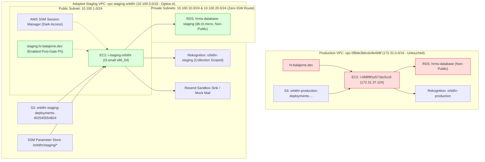

# OrbitHR HRMS — Isolated Staging Environment Implementation Plan
## Corrected Architecture: Option A Dedicated Staging VPC, Network Isolation & Phase 1 Execution Checklist

**Document Location:** `docs/ORBITHR_ISOLATED_STAGING_PLAN.md`  
**Target AWS Region:** `eu-north-1` (Stockholm)  
**Parent AWS Account:** `402545554824`  
**Production VPC (Untouched):** `vpc-0f8de3bbcdc8e468f` (CIDR `172.31.0.0/16`)  
**Adopted Staging VPC (Option A):** `vpc-staging-orbithr` (CIDR `10.100.0.0/16`)  
**Candidate Release:** `v1.5.9-p2.10-hardened-rc2` (`e249b412735eaa79773d974af43e35f779b1cc4a`)  
**Operational Budget Target:** **$50.00 / month**  
**Audit & Correction Timestamp:** 2026-10-10T19:40:00Z  
**Phase 1 Status:** **NOT AUTHORIZED FOR PROVISIONING (AWAITING OPERATOR AUTHORIZATION)**  
**Execution Mode:** Strictly Read-Only Design Correction (Not Provisioned / Not Executed)  

---

## 1. Executive Summary & Purpose

The Gate B forensic audit (`docs/P2_10_RC2_GATE_B_ENVIRONMENT_FORENSIC_AUDIT.md`) proved that the existing AWS infrastructure (`i-068f8f1e571bc5cc6` / `hrms-database`) is **live production**, serving active corporate employee records, payroll, and biometric data under `https://hr.balajione.dev`.

To resolve Gate B safely without risking production, this document defines a **cost-conscious, dedicated staging environment** in AWS `eu-north-1`. Following a comprehensive architectural comparison, this plan formally adopts **Option A: Dedicated Staging VPC**:
1. **Network-Isolated Staging VPC (`10.100.0.0/16`):** Staging compute and database reside in a separate VPC with zero routes, zero peering connections, and zero transit gateway links to production VPC `vpc-0f8de3bbcdc8e468f`. Staging is **network-isolated from production with controlled outbound connectivity**.
2. **True Private RDS Subnets:** Staging RDS resides in private subnets with RFC 1918 addresses only (`10.100.10.0/24` and `10.100.20.0/24`) and zero route table paths to any Internet Gateway or NAT Gateway. Staging EC2 resides in a public subnet (`10.100.1.0/24`) with public IPv4 and dark security groups, allowing direct SSM management and package updates without requiring an expensive NAT Gateway ($32.40/mo).
3. **Database Credential Separation:** Separates the RDS master provisioning credential (`orbit_stage_admin`) from the least-privilege application credential (`orbithr_staging_app`). Master credentials are never stored in `.env` or application runtime.
4. **Delayed Public Exposure & Dark Launch:** Staging EC2 host launches in a **completely dark state** (zero public ingress on ports 80/443/22). Web ingress is authorized only after internal deployment and migration gates (P1–P5) pass.
5. **Comprehensive Residual Cost Inventory & Teardown Guard:** Reconciles all 10 billable storage resources, mandates S3 incomplete multipart upload abortion, and enforces dependency-aware teardown with strict safeguards protecting production VPC, RDS, and snapshots.

---

## 2. Target Architecture & Environment Isolation Matrix



### Component Isolation Matrix

| Component | Production (Live Active) | Staging (Adopted Option A) | Physical Isolation Mechanism |
| :--- | :--- | :--- | :--- |
| **VPC & Address Space**| `vpc-0f8de3bbcdc8e468f` (`172.31.0.0/16`)| `vpc-staging-orbithr` (`10.100.0.0/16`)| Dedicated VPC; zero peering/routes between CIDRs |
| **Public Hostname** | `hr.balajione.dev` | `staging.hr.balajione.dev` | Distinct DNS A record in Cloudflare (unrouted until Gate P5) |
| **Compute Host** | `i-068f8f1e571bc5cc6` (`t3.medium`) | `i-staging-orbithr` (`t3.small`, `x86_64`) | Dedicated instance in staging public subnet; zero shared runtime |
| **Database Instance**| `hrms-database` (PostgreSQL 18.3) | `hrms-database-staging` (`db.t3.micro`) | Dedicated instance in staging private subnets; unique KMS encryption |
| **Database Data** | Live corporate employee & payroll data | 100% clean baseline; 5 mock test profiles | Zero production snapshot imports; migrations #1–32 fresh |
| **Database Users** | Production master/app users | `orbit_stage_admin` (Admin) / `orbithr_staging_app` (App) | Separate master and least-privilege app credentials |
| **Inbound Ports** | Port 80 & 443 open | **Zero Inbound Ports on Launch (Dark State)** | Public 80/443 enabled only after Gate P5; Port 22 eliminated |
| **Artifact Storage** | `orbithr-production-deployments-...` | `orbithr-staging-deployments-402545554824` | Dedicated private encrypted bucket; 3-day lifecycle |
| **IAM Instance Role**| Production EC2 Role | `OrbitHR-EC2-Staging-Role` | Scoped strictly to staging bucket, Rekognition & SSM |
| **CI/CD OIDC Role** | `OrbitHR-GitHub-Production-Deploy` | **DEFERRED** (Phase 1 uses local CLI + SSM) | Zero unverified OIDC roles provisioned |
| **Face Biometrics** | Production facial collection | `orbithr-staging` collection | Action-scoped Rekognition permissions |
| **Notifications** | Live production FCM & corporate email | Resend sandbox sink & isolated Firebase | Zero communications to real employee devices |
### D. Subnet Topology & SSM Reachability Architecture (Reconciled)

The staging network design enforces a clean separation of network tiers while maintaining zero inbound attack surface:

1. **Staging EC2 Instance Placement (`i-staging-orbithr`):**
   * **Subnet:** Strictly placed in **Public Subnet** `subnet-staging-public-1a` (`10.100.1.0/24`, AZ `eu-north-1a`).
   * **Public IP:** Assigned a public IPv4 address (`MapPublicIpOnLaunch: true`).
   * **Route Table:** `rtb-staging-public` with default egress route `0.0.0.0/0 -> igw-staging-orbithr`.
   * **Architectural Clarification:** **There is NO "private EC2 subnet" in Option A.** Placing EC2 in a private subnet would require either an AWS NAT Gateway ($0.045/hr + data transfer = ~$32.40/mo) or three VPC PrivateLink interface endpoints ($21.60/mo) to communicate with AWS Systems Manager. Option A intentionally eliminates this cost by using the public subnet with dark inbound security.
2. **EC2 Ingress & Dark Launch Posture:**
   * **Inbound Rules:** Attached Security Group `launch-wizard-staging` starts with **ZERO inbound rules** (`IpPermissions: []`). All ports (22, 80, 443) are completely closed.
   * **How SSM Session Manager Reaches the Host Without Inbound Access:**
     * The Amazon Linux 2023 SSM Agent operates via **outbound-only HTTPS connections (TCP port 443)** to AWS Systems Manager service endpoints (`ssm.eu-north-1.amazonaws.com`, `ssmmessages.eu-north-1.amazonaws.com`, `ec2messages.eu-north-1.amazonaws.com`) routed through the Internet Gateway.
     * Because AWS Security Groups are **stateful**, established outbound TCP sessions automatically permit return traffic. **Zero inbound ports are opened.**
     * Operators manage the instance, run commands, and tunnel database ports exclusively via AWS Systems Manager Session Manager (`aws ssm start-session`).
3. **Staging RDS Instance Placement (`hrms-database-staging`):**
   * **Subnets:** Dedicated DB Subnet Group `orbithr-staging-db-subnet-group` spanning **two private subnets**:
     * `subnet-staging-private-1a` (`10.100.10.0/24`, AZ `eu-north-1a`)
     * `subnet-staging-private-1b` (`10.100.20.0/24`, AZ `eu-north-1b`)
   * **Route Table:** `rtb-staging-private` containing **only** `10.100.0.0/16 -> local`.
   * **Zero Internet Route:** The private subnets have zero route to any Internet Gateway or NAT Gateway (`PubliclyAccessible: false`).
   * **Database Ingress:** Security Group `rds-staging-sg` permits TCP port 5432 **only** from source security group `ec2-rds-staging` (attached to the staging EC2 host).
   * The database is completely unreachable from the internet and from production VPC `vpc-0f8de3bbcdc8e468f`.

---

## 3. Subnet Topology Reality, Production Ingress Forensic Audit & Architecture Decision

### A. Forensic Audit of AWS VPC & Subnets
Live AWS CLI inspection of VPC `vpc-0f8de3bbcdc8e468f` reveals the following physical topology:
* **Subnets Present in Production VPC:**
  * `subnet-01b6187e3535d9049` (eu-north-1a, CIDR `172.31.16.0/20`, `MapPublicIpOnLaunch: true`)
  * `subnet-04a75597ba2f7df9c` (eu-north-1b, CIDR `172.31.32.0/20`, `MapPublicIpOnLaunch: true`)
  * `subnet-0d091cd08943c5f4c` (eu-north-1c, CIDR `172.31.0.0/20`, `MapPublicIpOnLaunch: true`)
* **Route Table Reality:** All three subnets associate with main route table `rtb-07c18af3192efc4a4`, which possesses a default route `0.0.0.0/0 -> igw-0ed6fdc9fba5a0d37` and a local route `172.31.0.0/16 -> local`.
* **Technical Classification:** Under AWS networking definitions, all subnets in `vpc-0f8de3bbcdc8e468f` are **public subnets**. **There are no dedicated private subnets in the production VPC.**

### B. Live Forensic Audit of Production RDS Ingress Rules
Read-only AWS inspection of production RDS instance `hrms-database` identified its exact security posture:
* **Endpoint:** `hrms-database.cdc6cyayy6za.eu-north-1.rds.amazonaws.com:5432` (Private IP in `172.31.0.0/16`)
* **Public Access:** `PubliclyAccessible: false`
* **Attached Security Groups:**
  1. `sg-0401226ecafcf0f3a` (`rds-ec2-1`):
     - Ingress Rule: TCP 5432 permitted ONLY from source security group `sg-0c0e2eb3683a9d89a` (`ec2-rds-1`).
  2. `sg-0f99206eef341303a` (`hrms-rds-sg`):
     - Ingress Rule: TCP 5432 permitted ONLY from single external CIDR `223.184.203.84/32`.
* **Cross-Environment Reachability Assessment:**
  - **Could Staging Reach Production RDS?**
    - **Under Intended Configuration (PASS):** Staging EC2 is launched with its own distinct security group `ec2-rds-staging` and does NOT have `sg-0c0e2eb3683a9d89a` attached. Staging EC2 does not originate from IP `223.184.203.84`. Therefore, all TCP packets from staging EC2 to `hrms-database:5432` are dropped by AWS hypervisor stateful firewall rules.
    - **Network Vulnerability in Shared VPC (Option B):** Because route table `rtb-07c18af3192efc4a4` routes `172.31.0.0/16` locally, Layer 3 IP routing exists between staging EC2 and production RDS. If an operator accidentally attaches `sg-0c0e2eb3683a9d89a` to staging EC2, staging gains immediate Layer 4 access to production RDS!
    - **In Dedicated Staging VPC (Option A):** No Layer 3 route exists between VPCs. Even if security group rules were misconfigured, traffic cannot bridge the physical VPC boundary.

### C. Network Architecture Decision Matrix: Option A vs. Option B

| Dimension | Option A: Dedicated Staging VPC (ADOPTED) | Option B: Existing Shared VPC (`vpc-0f8de3bbcdc8e468f`) | Winner & Justification |
| :--- | :--- | :--- | :--- |
| **Security Isolation** | **Network-isolated from production with controlled outbound connectivity (L3/L4 Boundary):** Staging resides in `10.100.0.0/16`. RDS in private subnets with zero IGW routes. Zero peering/routing to `172.31.0.0/16`. Complete protection against security group misconfiguration. | **Logical L4 Only:** Shares CIDR `172.31.0.0/16` and route table `rtb-07c18af3192efc4a4`. Relies solely on SG rules (`sg-0401226ecafcf0f3a`). Human error in SG attachment immediately breaches isolation. | **Option A (Adopted):** Hardware-level VPC separation eliminates blast radius to production database. |
| **Operational Complexity** | **Moderate:** Requires 1 VPC (`10.100.0.0/16`), 1 IGW, 3 subnets (1 public, 2 private), 2 route tables, and 1 DB subnet group (~10 CLI commands). | **Low:** Reuses existing VPC, subnets, and default DB subnet group. | **Option B:** Fewer initial resources, though offset by higher risk of accidental changes to shared VPC. |
| **Estimated Run-Rate Cost** | **$38.15 / month:** EC2 `t3.small` ($16.79) in public subnet with public IP; RDS `db.t3.micro` ($13.14) in private subnets; 2x20GB gp3 ($4.52); Public IP ($3.65); S3/Rekognition ($0.05). **Zero NAT Gateway required** (EC2 reaches SSM/internet directly via IGW; RDS communicates with EC2 via local VPC route). | **$38.15 / month:** Identical compute, storage, and networking charges. | **TIE:** Both stay well within the $50.00/month budget target without requiring costly NAT Gateways ($32.40/mo). |
| **Teardown Risk** | **Zero Production Blast Radius:** Staging VPC has an independent resource ID. Deleting `vpc-staging-orbithr` and its subnets has zero mathematical chance of deleting production VPC resources. | **High Shared Risk:** Teardown occurs inside `vpc-0f8de3bbcdc8e468f`. A script flaw or CLI typo could alter shared route tables, subnets, or default security groups. | **Option A (Adopted):** Isolated lifecycle prevents accidental disruption of production networking. |

### D. Architectural Decision & Confirmation of Zero Cross-VPC Routes
**DECISION: OPTION A (Dedicated Staging VPC) IS ADOPTED.**  
Option A provides genuine physical isolation, enables true private RDS subnets without internet routes, introduces zero additional AWS costs compared to Option B ($38.15/mo vs. $38.15/mo by omitting NAT Gateways and using SSM directly on the public EC2 host), and guarantees zero blast radius to production during teardown.

**Cross-VPC Route Isolation Proof:**
1. Zero peering connections exist between `10.100.0.0/16` and `172.31.0.0/16` (`describe-vpc-peering-connections` returns `[]`).
2. Zero Transit Gateway attachments exist (`describe-transit-gateway-attachments` returns `[]`).
3. Staging route tables have **no destination route** for `172.31.0.0/16`.
4. Production route table `rtb-07c18af3192efc4a4` has **no destination route** for `10.100.0.0/16`.
5. Traffic between staging and production VPCs is physically unroutable at the AWS hypervisor level.

---

## 4. Database Credential Separation & Secret Management

Master administrative credentials and application runtime credentials must be strictly separated.

### A. Credential Partitioning

| Credential | Identity / Username | Purpose | Access Scope | Storage Location |
| :--- | :--- | :--- | :--- | :--- |
| **RDS Master Admin** | `orbit_stage_admin` | RDS provisioning, initial DB creation, extension installation | Provisioning time & operator administrative maintenance only | SSM Parameter `/orbithr/staging/database/master_password` (`SecureString`) |
| **Application User** | `orbithr_staging_app` | Runtime queries, connection pooling, Prisma schema migrations | Scoped strictly to database `hrms_staging`, schema `public` | SSM Parameter `/orbithr/staging/database/app_password` (`SecureString`) & `/home/ec2-user/orbithr-shared/.env` |

### B. Application User Least-Privilege Grants
During initial database setup via SSM port forwarding or initial host bootstrap, `orbit_stage_admin` provisions `orbithr_staging_app`:
```sql
-- 1. Create dedicated database
CREATE DATABASE hrms_staging;

-- 2. Create least-privilege application user
CREATE USER orbithr_staging_app WITH PASSWORD '<APP_PASSWORD>';

-- 3. Grant schema permissions (Zero Superuser, Zero RDS Admin rights)
GRANT CONNECT ON DATABASE hrms_staging TO orbithr_staging_app;
\c hrms_staging
GRANT USAGE, CREATE ON SCHEMA public TO orbithr_staging_app;
GRANT ALL PRIVILEGES ON ALL TABLES IN SCHEMA public TO orbithr_staging_app;
GRANT ALL PRIVILEGES ON ALL SEQUENCES IN SCHEMA public TO orbithr_staging_app;
ALTER DEFAULT PRIVILEGES IN SCHEMA public GRANT ALL ON TABLES TO orbithr_staging_app;
ALTER DEFAULT PRIVILEGES IN SCHEMA public GRANT ALL ON SEQUENCES TO orbithr_staging_app;
```

### C. Secure Secret Delivery & File Protections
1. **SSM Parameter Store Delivery:** Both passwords are generated as 32-character CSPRNG strings and stored as encrypted `SecureString` parameters under `/orbithr/staging/database/`.
2. **Instance Profile Restriction:** Staging EC2 instance role `OrbitHR-EC2-Staging-Role` has IAM permissions to read `/orbithr/staging/database/app_password`. It is **denied access** to master password parameter `/orbithr/staging/database/master_password`.
3. **Host Permissions:** Staging `.env` is written at `/home/ec2-user/orbithr-shared/.env` with file mode `0600` owned by `ec2-user:ec2-user`.
4. **Leakage Protection:** Passwords are never echoed to console, logged to system journal, or included in Git or tarball archives (strictly excluded via `--exclude='.env*'`).

---

## 5. Teardown Procedure, Billable Resource Inventory & Residual Cost Realism

### A. Inventory of All Billable Staging Resources

| Resource | Billing Type | Deletion Mechanism | Residual Risk if Missed |
| :--- | :--- | :--- | :--- |
| **EC2 Instance** | Per-second compute | `aws ec2 terminate-instances` | Billed if stopped ($0.023/hr if running) |
| **Public IPv4 Address** | Per-hour allocation | Automatic release on instance termination | Billed at $0.005/hr ($3.60/mo) if retained |
| **Root EBS Volume (20GB)**| Per-GB-month storage | `DeleteOnTermination: true` on root device | Billed at $0.088/GB-mo ($1.76/mo) if detached |
| **RDS Instance** | Per-second compute | `aws rds delete-db-instance --skip-final-snapshot` | Billed if stopped (auto-restarts after 7 days) |
| **RDS Allocated Storage** | Per-GB-month storage | Deleted with RDS instance | Billed at $0.138/GB-mo ($2.76/mo) if retained |
| **RDS Automated Backups** | Backup storage | Deleted via `--delete-automated-backups` | Purged on DB deletion |
| **Retained Automated Backups**| Backup storage | `aws rds delete-db-instance-automated-backup` | Billed at standard backup rates if retained post-delete |
| **RDS Manual Snapshots** | Per-GB-month storage | `aws rds delete-db-snapshot` (Do NOT create) | Billed at $0.095/GB-mo indefinitely if created |
| **S3 Deployment Objects** | Storage per GB-mo | `aws s3 rm s3://bucket --recursive` | Billed at $0.023/GB-mo if objects linger |
| **S3 Incomplete Multiparts**| Storage per GB-mo | S3 Lifecycle rule `AbortIncompleteMultipartUpload` & abort script | Billed for partial uploads if not aborted |
| **Rekognition Collection** | Per-model storage | `aws rekognition delete-collection` | Free tier covers 5,000 comparisons/mo |

### B. Budget Target Realism ($50.00/Month) & Database Class Reconciliation

* The **$50.00/month** limit is an **operational management ceiling**, NOT a native AWS hard spending cap. AWS will not terminate running instances when spend exceeds $50 unless AWS Budgets Actions are explicitly deployed.
* To guarantee spend drops to **$0.00/month post-teardown**, the operator must perform full deletion rather than stopping instances, and verify the post-teardown checklist.

#### 1. RDS PostgreSQL Instance Class Reconciliation (`db.t3.micro` vs `db.t4g.micro`)
An early exploratory note in the Gate B forensic audit tentatively suggested `db.t4g.micro` (AWS Graviton2). In this isolated staging plan, **`db.t3.micro` is the formally adopted instance class** for the following reasons:
1. **100% Architecture & Engine Parity:** Production `hrms-database` runs PostgreSQL 18.3 on x86_64 architecture. Selecting `db.t3.micro` preserves x86_64 CPU architecture parity with production, ensuring identical query planner characteristics and eliminating any ARM/Graviton binary or collation differences.
2. **Pricing Parity in `eu-north-1`:**
   * `db.t3.micro` (Single-AZ PostgreSQL 18.3, x86_64): **$0.018 / hr** (~$13.14 / month for 730 hours).
   * `db.t4g.micro` (Single-AZ PostgreSQL 18.3, Graviton2): **$0.016 / hr** (~$11.68 / month for 730 hours).
   * The cost differential is merely **$1.46 / month**, well within the operational margin.
   * `db.t3.micro` is adopted as the primary configuration across all Phase 1 scripts and cost tables.

#### 2. Itemized Run-Rate Cost Breakdown (24/7 vs. 3-Day Test Run)

| Billable Resource | Specification / Sizing | Hourly / Unit Rate (`eu-north-1`) | Continuous 24/7 (730h) | 3-Day Test Run (72h) |
| :--- | :--- | :--- | :--- | :--- |
| **EC2 Compute** | `t3.small` (2 vCPU, 2 GiB RAM, AL2023 x86_64) | $0.023 / hr | $16.79 / mo | $1.66 |
| **In-Use Public IPv4** | Single IPv4 for Staging EC2 host | $0.005 / hr | $3.65 / mo | $0.36 |
| **Root EBS Volume** | 20 GiB gp3 (`DeleteOnTermination: true`) | $0.088 / GB-mo | $1.76 / mo | $0.17 |
| **RDS Compute** | `db.t3.micro` (Single-AZ PostgreSQL 18.3, x86_64) | $0.018 / hr | $13.14 / mo | $1.30 |
| **RDS Storage** | 20 GiB gp3 allocated storage | $0.138 / GB-mo | $2.76 / mo | $0.27 |
| **S3 Release Bucket** | Ephemeral release archive (~1 GiB, 3-day lifecycle) | $0.023 / GB-mo | $0.05 / mo | $0.01 |
| **Rekognition Collection** | `orbithr-staging` (5 mock faces, <5k comparisons) | Free Tier | $0.00 / mo | $0.00 |
| **SSM Parameter Store** | Standard parameters (`/orbithr/staging/*`) | Free Tier | $0.00 / mo | $0.00 |
| **AWS Systems Manager** | Session Manager (Dark Access via IGW) | Free Tier | $0.00 / mo | $0.00 |
| **VPC & Internet Gateway** | Dedicated VPC + IGW (Option A) | Free | $0.00 / mo | $0.00 |
| **NAT Gateway** | **OMITTED** (EC2 reaches SSM directly via IGW) | **$0.00** ($32.40 saved) | **$0.00 / mo** | **$0.00** |
| **Total Expenditure** | | | **$38.15 / month** | **~$3.77** |

* **Operational Headroom:** At **$38.15/month**, the continuous run-rate provides **$11.85 (23.7%) headroom** below the $50.00/month management ceiling.
* **Test Run Realism:** For a 3-day verification cycle (72 hours), the net cost is **under $4.00**.

### C. Dependency-Aware Teardown Procedure with Safety Checks
Before executing deletion, the teardown routine enforces non-bypassable safeguards:
```powershell
$stagingInstanceId = '<STAGING_INSTANCE_ID>'
$stagingRdsId = 'hrms-database-staging'
$stagingBucket = 'orbithr-staging-deployments-402545554824'
$stagingVpcId = '<STAGING_VPC_ID>' # Must be vpc-staging-orbithr (10.100.0.0/16)

# Safe AWS CLI invocation wrapper: enforces non-zero exit code checking and terminates on failure
function Invoke-SafeAws {
    param(
        [Parameter(Mandatory)][string[]]$Arguments,
        [switch]$IgnoreError
    )
    $prev = $ErrorActionPreference
    $ErrorActionPreference = 'Continue'
    try {
        $output = & aws @Arguments --profile orbithr-local --region eu-north-1 2>&1
        $exitCode = $LASTEXITCODE
    }
    finally {
        $ErrorActionPreference = $prev
    }
    if ($exitCode -ne 0 -and -not $IgnoreError) {
        $errText = ($output -join "`n").Trim()
        throw "AWS CLI FAILURE [Exit Code $exitCode]: $errText"
    }
    return $output
}

# Fail-Closed Safety Assertions
if ($stagingInstanceId -eq 'i-068f8f1e571bc5cc6') { throw "FATAL: Attempted to terminate production EC2 host!" }
if ($stagingRdsId -eq 'hrms-database') { throw "FATAL: Attempted to delete production RDS database!" }
if ($stagingBucket -eq 'orbithr-production-deployments-402545554824') { throw "FATAL: Attempted to purge production S3 bucket!" }
if ($stagingVpcId -eq 'vpc-0f8de3bbcdc8e468f') { throw "FATAL: Attempted to delete production shared VPC!" }

# Assert-StagingOwnership: Strict Fail-Closed Validator for Every Teardown Action
function Assert-StagingOwnership {
    param(
        [Parameter(Mandatory)][string]$ResourceId,
        [Parameter(Mandatory)][ValidateSet('EC2', 'VPC', 'Subnet', 'RouteTable', 'InternetGateway', 'SecurityGroup', 'RDS', 'DBSnapshot', 'S3', 'IAM')][string]$ResourceType
    )
    # 1. Hard-block production resources
    $productionBlocklist = @(
        'i-068f8f1e571bc5cc6',
        'hrms-database',
        'orbithr-production-deployments-402545554824',
        'vpc-0f8de3bbcdc8e468f',
        'orbithr-pre-p2-10-rc2-snapshot'
    )
    if ($ResourceId -in $productionBlocklist -or $ResourceId -like 'rds:hrms-database-*') {
        throw "CRITICAL BREACH: Attempted deletion of PRODUCTION resource '$ResourceId'!"
    }

    # 2. Assert positive staging ownership tags using service-appropriate APIs (Zero error suppression)
    switch ($ResourceType) {
        { $_ -in @('EC2', 'VPC', 'Subnet', 'RouteTable', 'InternetGateway', 'SecurityGroup') } {
            $tagOutput = Invoke-SafeAws -Arguments @(
                'ec2', 'describe-tags',
                '--filters', "Name=resource-id,Values=$ResourceId", "Name=key,Values=Environment",
                '--query', 'Tags[0].Value',
                '--output', 'text'
            )
            $tagValue = ($tagOutput | Out-String).Trim()
            if ($tagValue -ne 'Staging') {
                throw "FATAL: Resource '$ResourceId' cannot be positively verified with tag Environment=Staging (got '$tagValue')! Aborting teardown."
            }
        }
        'RDS' {
            # Dedicated RDS tag verification using aws rds list-tags-for-resource
            $rdsArn = "arn:aws:rds:eu-north-1:402545554824:db:$ResourceId"
            $tagOutput = Invoke-SafeAws -Arguments @(
                'rds', 'list-tags-for-resource',
                '--resource-name', $rdsArn,
                '--query', "TagList[?Key=='Environment'].Value | [0]",
                '--output', 'text'
            )
            $tagValue = ($tagOutput | Out-String).Trim()
            if ($tagValue -ne 'Staging') {
                throw "FATAL: RDS instance '$ResourceId' cannot be positively verified with tag Environment=Staging (got '$tagValue')! Aborting teardown."
            }
        }
        'DBSnapshot' {
            $snapArn = "arn:aws:rds:eu-north-1:402545554824:snapshot:$ResourceId"
            $tagOutput = Invoke-SafeAws -Arguments @(
                'rds', 'list-tags-for-resource',
                '--resource-name', $snapArn,
                '--query', "TagList[?Key=='Environment'].Value | [0]",
                '--output', 'text'
            )
            $tagValue = ($tagOutput | Out-String).Trim()
            if ($tagValue -ne 'Staging') {
                throw "FATAL: RDS snapshot '$ResourceId' cannot be positively verified with tag Environment=Staging (got '$tagValue')! Aborting teardown."
            }
        }
        'S3' {
            if ($ResourceId -eq 'orbithr-production-deployments-402545554824' -or $ResourceId -like '*production*') {
                throw "FATAL: Attempted deletion of production S3 bucket '$ResourceId'!"
            }
            if ($ResourceId -ne 'orbithr-staging-deployments-402545554824') {
                throw "FATAL: S3 bucket '$ResourceId' does not match expected staging bucket! Aborting teardown."
            }
            $tagOutput = Invoke-SafeAws -Arguments @(
                's3api', 'get-bucket-tagging',
                '--bucket', $ResourceId,
                '--query', "TagSet[?Key=='Environment'].Value | [0]",
                '--output', 'text'
            )
            $tagValue = ($tagOutput | Out-String).Trim()
            if ($tagValue -ne 'Staging') {
                throw "FATAL: S3 bucket '$ResourceId' cannot be positively verified with tag Environment=Staging (got '$tagValue')! Aborting teardown."
            }
        }
        'IAM' {
            if ($ResourceId -ne 'OrbitHR-EC2-Staging-Role') {
                throw "FATAL: IAM resource '$ResourceId' does not match expected staging role name! Aborting teardown."
            }
            $tagOutput = Invoke-SafeAws -Arguments @(
                'iam', 'list-role-tags',
                '--role-name', $ResourceId,
                '--query', "Tags[?Key=='Environment'].Value | [0]",
                '--output', 'text'
            )
            $tagValue = ($tagOutput | Out-String).Trim()
            if ($tagValue -ne 'Staging') {
                throw "FATAL: IAM Role '$ResourceId' cannot be positively verified with tag Environment=Staging (got '$tagValue')! Aborting teardown."
            }
        }
    }
}

# Assert Staging Tag on EC2 Host
Assert-StagingOwnership -ResourceId $stagingInstanceId -ResourceType 'EC2'

Write-Host "Executing Dependency-Aware Staging Teardown..." -ForegroundColor Cyan

# 1. Terminate EC2 Host (Root volume deleted automatically via DeleteOnTermination: true)
Invoke-SafeAws -Arguments @('ec2', 'terminate-instances', '--instance-ids', $stagingInstanceId) | Out-Null
Invoke-SafeAws -Arguments @('ec2', 'wait', 'instance-terminated', '--instance-ids', $stagingInstanceId) | Out-Null

# 2. Check for & Delete Lingering Unattached EBS Volumes tagged OrbitHR-Staging
$unattachedVolumesRaw = (Invoke-SafeAws -Arguments @(
    'ec2', 'describe-volumes',
    '--filters', 'Name=tag:Name,Values=OrbitHR-Staging', 'Name=status,Values=available',
    '--query', 'Volumes[].VolumeId',
    '--output', 'text'
) | Out-String).Trim()

if ($unattachedVolumesRaw) {
    foreach ($volId in $unattachedVolumesRaw.Split(" `t`n`r", [StringSplitOptions]::RemoveEmptyEntries)) {
        Write-Host "Deleting unattached staging EBS volume: $volId" -ForegroundColor Yellow
        Invoke-SafeAws -Arguments @('ec2', 'delete-volume', '--volume-id', $volId) | Out-Null
    }
}

# 3. Handle Staging RDS Manual Snapshots, Retained Backups & Delete RDS Instance
# A. Purge any staging-specific manual snapshots (strictly protect production snapshot orbithr-pre-p2-10-rc2-snapshot)
$stagingSnapshotsRaw = (Invoke-SafeAws -Arguments @(
    'rds', 'describe-db-snapshots',
    '--query', "DBSnapshots[?DBInstanceIdentifier=='$stagingRdsId'].DBSnapshotIdentifier",
    '--output', 'text'
) | Out-String).Trim()

if ($stagingSnapshotsRaw) {
    foreach ($snapId in $stagingSnapshotsRaw.Split(" `t`n`r", [StringSplitOptions]::RemoveEmptyEntries)) {
        if ($snapId -eq 'orbithr-pre-p2-10-rc2-snapshot' -or $snapId -like 'rds:hrms-database-*') {
            throw "FATAL: Refusing to delete production snapshot ($snapId)!"
        }
        Assert-StagingOwnership -ResourceId $snapId -ResourceType 'DBSnapshot'
        Write-Host "Deleting staging manual snapshot: $snapId" -ForegroundColor Yellow
        Invoke-SafeAws -Arguments @('rds', 'delete-db-snapshot', '--db-snapshot-identifier', $snapId) | Out-Null
    }
}

# B. Assert positive ownership of RDS instance, then delete (Mandate --skip-final-snapshot & --delete-automated-backups)
Assert-StagingOwnership -ResourceId $stagingRdsId -ResourceType 'RDS'
Invoke-SafeAws -Arguments @('rds', 'delete-db-instance', '--db-instance-identifier', $stagingRdsId, '--skip-final-snapshot', '--delete-automated-backups') | Out-Null
Invoke-SafeAws -Arguments @('rds', 'wait', 'db-instance-deleted', '--db-instance-identifier', $stagingRdsId) | Out-Null

# C. Check for and delete any lingering Retained Automated Backups for staging (Zero error suppression)
$retainedBackupsRaw = (Invoke-SafeAws -Arguments @(
    'rds', 'describe-db-instance-automated-backups',
    '--db-instance-identifier', $stagingRdsId,
    '--query', 'DBInstanceAutomatedBackups[].DbiResourceId',
    '--output', 'text'
) | Out-String).Trim()

if ($retainedBackupsRaw) {
    foreach ($dbiId in $retainedBackupsRaw.Split(" `t`n`r", [StringSplitOptions]::RemoveEmptyEntries)) {
        Write-Host "Deleting retained automated backup: $dbiId" -ForegroundColor Yellow
        Invoke-SafeAws -Arguments @('rds', 'delete-db-instance-automated-backup', '--dbi-resource-id', $dbiId) | Out-Null
    }
}

# 4. Handle S3 Incomplete Multipart Uploads, Object Purge & Bucket Deletion
# A. Abort any incomplete multipart uploads (these are not deleted by standard 's3 rm')
$incompleteUploadsJson = (Invoke-SafeAws -Arguments @(
    's3api', 'list-multipart-uploads',
    '--bucket', $stagingBucket,
    '--query', 'Uploads[].{Key:Key,UploadId:UploadId}',
    '--output', 'json'
) | Out-String)

if ($incompleteUploadsJson -and $incompleteUploadsJson.Trim() -ne 'null') {
    $incompleteUploads = $incompleteUploadsJson | ConvertFrom-Json
    foreach ($upload in $incompleteUploads) {
        Write-Host "Aborting incomplete multipart upload: $($upload.Key)" -ForegroundColor Yellow
        Invoke-SafeAws -Arguments @('s3api', 'abort-multipart-upload', '--bucket', $stagingBucket, '--key', $upload.Key, '--upload-id', $upload.UploadId) | Out-Null
    }
}

# B. Assert S3 ownership, recursively remove all objects and delete bucket
Assert-StagingOwnership -ResourceId $stagingBucket -ResourceType 'S3'
Invoke-SafeAws -Arguments @('s3', 'rm', "s3://$stagingBucket", '--recursive') | Out-Null
Invoke-SafeAws -Arguments @('s3api', 'delete-bucket', '--bucket', $stagingBucket) | Out-Null

# 5. Delete Rekognition Collection
Invoke-SafeAws -Arguments @('rekognition', 'delete-collection', '--collection-id', 'orbithr-staging') | Out-Null

# 6. Delete SSM Parameters
Invoke-SafeAws -Arguments @('ssm', 'delete-parameter', '--name', '/orbithr/staging/database/master_password') | Out-Null
Invoke-SafeAws -Arguments @('ssm', 'delete-parameter', '--name', '/orbithr/staging/database/app_password') | Out-Null

# 7. Delete Security Groups in Staging VPC (In reverse dependency order)
Assert-StagingOwnership -ResourceId $rdsSgId -ResourceType 'SecurityGroup'
Assert-StagingOwnership -ResourceId $clientSgId -ResourceType 'SecurityGroup'
Assert-StagingOwnership -ResourceId $webSgId -ResourceType 'SecurityGroup'
Invoke-SafeAws -Arguments @('ec2', 'delete-security-group', '--group-id', $rdsSgId) | Out-Null
Invoke-SafeAws -Arguments @('ec2', 'delete-security-group', '--group-id', $clientSgId) | Out-Null
Invoke-SafeAws -Arguments @('ec2', 'delete-security-group', '--group-id', $webSgId) | Out-Null

# 8. Delete IAM Role and Instance Profile
Assert-StagingOwnership -ResourceId 'OrbitHR-EC2-Staging-Role' -ResourceType 'IAM'
Invoke-SafeAws -Arguments @('iam', 'remove-role-from-instance-profile', '--instance-profile-name', 'OrbitHR-EC2-Staging-Role', '--role-name', 'OrbitHR-EC2-Staging-Role') | Out-Null
Invoke-SafeAws -Arguments @('iam', 'delete-instance-profile', '--instance-profile-name', 'OrbitHR-EC2-Staging-Role') | Out-Null
Invoke-SafeAws -Arguments @('iam', 'delete-role-policy', '--role-name', 'OrbitHR-EC2-Staging-Role', '--policy-name', 'OrbitHR-Staging-S3-Read') | Out-Null
Invoke-SafeAws -Arguments @('iam', 'delete-role-policy', '--role-name', 'OrbitHR-EC2-Staging-Role', '--policy-name', 'OrbitHR-Staging-Rekognition') | Out-Null
Invoke-SafeAws -Arguments @('iam', 'delete-role-policy', '--role-name', 'OrbitHR-EC2-Staging-Role', '--policy-name', 'OrbitHR-Staging-SSM-Params') | Out-Null
Invoke-SafeAws -Arguments @('iam', 'detach-role-policy', '--role-name', 'OrbitHR-EC2-Staging-Role', '--policy-arn', 'arn:aws:iam::aws:policy/AmazonSSMManagedInstanceCore') | Out-Null
Invoke-SafeAws -Arguments @('iam', 'delete-role', '--role-name', 'OrbitHR-EC2-Staging-Role') | Out-Null

# 9. Delete DB Subnet Group
Invoke-SafeAws -Arguments @('rds', 'delete-db-subnet-group', '--db-subnet-group-name', 'orbithr-staging-db-subnet-group') | Out-Null

# 10. Delete Staging VPC Network Infrastructure (Option A)
# A. Delete Subnets
Assert-StagingOwnership -ResourceId $stagingPublicSubnetId -ResourceType 'Subnet'
Assert-StagingOwnership -ResourceId $stagingPrivateSubnet1Id -ResourceType 'Subnet'
Assert-StagingOwnership -ResourceId $stagingPrivateSubnet2Id -ResourceType 'Subnet'
Invoke-SafeAws -Arguments @('ec2', 'delete-subnet', '--subnet-id', $stagingPublicSubnetId) | Out-Null
Invoke-SafeAws -Arguments @('ec2', 'delete-subnet', '--subnet-id', $stagingPrivateSubnet1Id) | Out-Null
Invoke-SafeAws -Arguments @('ec2', 'delete-subnet', '--subnet-id', $stagingPrivateSubnet2Id) | Out-Null

# B. Delete Route Tables
Assert-StagingOwnership -ResourceId $stagingPublicRouteTableId -ResourceType 'RouteTable'
Assert-StagingOwnership -ResourceId $stagingPrivateRouteTableId -ResourceType 'RouteTable'
Invoke-SafeAws -Arguments @('ec2', 'delete-route-table', '--route-table-id', $stagingPublicRouteTableId) | Out-Null
Invoke-SafeAws -Arguments @('ec2', 'delete-route-table', '--route-table-id', $stagingPrivateRouteTableId) | Out-Null

# C. Detach and Delete Internet Gateway
Assert-StagingOwnership -ResourceId $stagingIgwId -ResourceType 'InternetGateway'
Invoke-SafeAws -Arguments @('ec2', 'detach-internet-gateway', '--internet-gateway-id', $stagingIgwId, '--vpc-id', $stagingVpcId) | Out-Null
Invoke-SafeAws -Arguments @('ec2', 'delete-internet-gateway', '--internet-gateway-id', $stagingIgwId) | Out-Null

# D. Delete Staging VPC
Assert-StagingOwnership -ResourceId $stagingVpcId -ResourceType 'VPC'
Invoke-SafeAws -Arguments @('ec2', 'delete-vpc', '--vpc-id', $stagingVpcId) | Out-Null

Write-Host "[SUCCESS] Staging Teardown Completed. Zero Shared Production Resources Modified." -ForegroundColor Green
```

### D. Post-Teardown Verification Commands
```powershell
# 1. Confirm zero running/stopped staging EC2 instances:
aws ec2 describe-instances --filters "Name=tag:Name,Values=OrbitHR-Staging" "Name=instance-state-name,Values=pending,running,stopping,stopped" --query "Reservations[].Instances[].InstanceId" --output text --profile orbithr-local

# 2. Confirm zero lingering unattached EBS volumes:
aws ec2 describe-volumes --filters "Name=tag:Name,Values=OrbitHR-Staging" --query "Volumes[].VolumeId" --output text --profile orbithr-local

# 3. Confirm RDS database deleted:
aws rds describe-db-instances --db-instance-identifier hrms-database-staging 2>&1

# 4a. Confirm zero manual staging RDS snapshots:
aws rds describe-db-snapshots --db-instance-identifier hrms-database-staging --snapshot-type manual 2>&1

# 4b. Confirm zero retained automated backups for staging:
aws rds describe-db-instance-automated-backups --db-instance-identifier hrms-database-staging 2>&1

# 4c. Verify production manual snapshot remains intact:
aws rds describe-db-snapshots --db-snapshot-identifier orbithr-pre-p2-10-rc2-snapshot --query "DBSnapshots[0].Status" --output text --profile orbithr-local

# 5. Confirm S3 bucket deleted and zero multipart uploads linger:
aws s3 ls s3://orbithr-staging-deployments-402545554824 2>&1

# 6. Confirm zero staging SSM parameters:
aws ssm get-parameters-by-path --path "/orbithr/staging" --profile orbithr-local --region eu-north-1 --query "Parameters[].Name"

# 7. Confirm staging VPC deleted:
aws ec2 describe-vpcs --filters "Name=tag:Name,Values=vpc-staging-orbithr" --query "Vpcs[].VpcId" --output text --profile orbithr-local
```

---

## 6. Public Exposure, DNS & TLS Gating

The staging host must not be exposed to the public internet during initial provisioning or migration testing.

### A. Gated Public Ingress Phases
1. **Phase 1 to Phase 4 (Dark State):**
   * Security group `launch-wizard-staging` contains **ZERO inbound rules**.
   * All administrative setup, environment configuration, package extraction, and migration testing run through **AWS Systems Manager (SSM) Session Manager** and SSM port-forwarding.
   * Public ports 80 and 443 are closed.
2. **Phase 5 (Gated Public Exposure & TLS):**
   * Pre-condition: Gates P1 through P5 must pass 100%.
   * Step 5a: Authorize inbound TCP 80 & 443 on `launch-wizard-staging`:
     ```powershell
     aws ec2 authorize-security-group-ingress --group-id $webSgId --protocol tcp --port 80 --cidr 0.0.0.0/0 --profile orbithr-local
     aws ec2 authorize-security-group-ingress --group-id $webSgId --protocol tcp --port 443 --cidr 0.0.0.0/0 --profile orbithr-local
     ```
   * Step 5b: Create DNS A record `staging.hr.balajione.dev` pointing to staging EC2 public IPv4 in Cloudflare dashboard.
   * Step 5c: Run Let's Encrypt Certbot via SSM on the host:
     ```bash
     certbot --nginx -d staging.hr.balajione.dev --non-interactive --agree-tos -m admin@balajione.dev
     ```
3. **Failure & Rollback Procedure:**
   * If Certbot fails, or if staging smoke tests fail, immediately revoke public ingress:
     ```powershell
     aws ec2 revoke-security-group-ingress --group-id $webSgId --protocol tcp --port 80 --cidr 0.0.0.0/0 --profile orbithr-local
     aws ec2 revoke-security-group-ingress --group-id $webSgId --protocol tcp --port 443 --cidr 0.0.0.0/0 --profile orbithr-local
     ```
   * The host immediately returns to a dark state while issues are investigated via SSM.

---

## 7. Step-by-Step Provisioning Procedure (Preconditions & Stop Conditions)

Each provisioning step contains explicit preconditions, execution commands, and fail-closed stop conditions:

### Step 0: Mandatory Global Preflight & Collision Assertion (Fail-Closed)
* **Preconditions:** AWS CLI v2 installed; execution targeting profile `orbithr-local` and region `eu-north-1`.
* **Execution:**
  ```powershell
  # Safe AWS CLI invocation wrapper: enforces native exit code checks and throws on any non-zero exit
  function Invoke-SafeAws {
      param(
          [Parameter(Mandatory)][string[]]$Arguments,
          [switch]$IgnoreError
      )
      $prev = $ErrorActionPreference
      $ErrorActionPreference = 'Continue'
      try {
          $output = & aws @Arguments --profile orbithr-local --region eu-north-1 2>&1
          $exitCode = $LASTEXITCODE
      }
      finally {
          $ErrorActionPreference = $prev
      }
      if ($exitCode -ne 0 -and -not $IgnoreError) {
          $errText = ($output -join "`n").Trim()
          throw "AWS CLI FAILURE [Exit Code $exitCode]: $errText"
      }
      return $output
  }

  Write-Host "=== OrbitHR Staging Phase 1 — Step 0: Global Preflight & Collision Assertion ===" -ForegroundColor Cyan

  # 1. Verify AWS Authentication & Account ID (402545554824)
  $identityJson = (Invoke-SafeAws -Arguments @('sts', 'get-caller-identity', '--output', 'json') | Out-String)
  $identity = $identityJson | ConvertFrom-Json
  if (-not $identity -or -not $identity.Account) {
      throw "FATAL: Inconclusive STS caller identity lookup!"
  }
  if ($identity.Account -ne '402545554824') {
      throw "FATAL: Authenticated account mismatch! Expected '402545554824', got '$($identity.Account)'."
  }
  if ($identity.Arn -match ':root$') {
      throw "FAIL-CLOSED: Authenticated as AWS Account ROOT identity ($($identity.Arn))! AWS Security Best Practices prohibit root credentials for routine infrastructure provisioning. A dedicated least-privilege IAM identity is required."
  }
  Write-Host "[PREFLIGHT PASS] Authenticated as $($identity.Arn) in account 402545554824." -ForegroundColor Green

  # 2. Verify AWS Target Region (eu-north-1)
  $configuredRegion = (Invoke-SafeAws -Arguments @('configure', 'get', 'region', '--profile', 'orbithr-local') | Out-String).Trim()
  if ($configuredRegion -and ($configuredRegion -ne 'eu-north-1')) {
      throw "FATAL: Profile region is configured to '$configuredRegion', expected 'eu-north-1'!"
  }
  Write-Host "[PREFLIGHT PASS] Target region verified: eu-north-1." -ForegroundColor Green

  # 3. Verify PostgreSQL 18.3 & db.t3.micro Orderability in eu-north-1
  $orderableRaw = (Invoke-SafeAws -Arguments @(
      'rds', 'describe-orderable-db-instance-options',
      '--engine', 'postgres',
      '--engine-version', '18.3',
      '--db-instance-class', 'db.t3.micro',
      '--query', 'OrderableDBInstanceOptions[0].DBInstanceClass',
      '--output', 'text'
  ) | Out-String).Trim()

  if (-not $orderableRaw -or $orderableRaw -eq 'None' -or $orderableRaw -ne 'db.t3.micro') {
      throw "FATAL: db.t3.micro is NOT supported for PostgreSQL 18.3 in eu-north-1 (got '$orderableRaw')! Aborting before any resource creation."
  }
  Write-Host "[PREFLIGHT PASS] RDS orderability verified: PostgreSQL 18.3 on db.t3.micro is orderable in eu-north-1." -ForegroundColor Green

  # 4. Collision Check: Verify Zero Collisions on Staging Names Before Resource Creation
  # A. Staging VPC Collision Check
  $existingVpcs = (Invoke-SafeAws -Arguments @(
      'ec2', 'describe-vpcs',
      '--filters', 'Name=tag:Name,Values=vpc-staging-orbithr',
      '--query', 'Vpcs[].VpcId',
      '--output', 'text'
  ) | Out-String).Trim()
  if ($existingVpcs) {
      throw "FATAL: Staging VPC 'vpc-staging-orbithr' already exists ($existingVpcs)! Aborting before creation."
  }

  # B. Staging RDS Instance Collision Check
  $existingRds = (Invoke-SafeAws -Arguments @(
      'rds', 'describe-db-instances',
      '--query', "DBInstances[?DBInstanceIdentifier=='hrms-database-staging'].DBInstanceIdentifier",
      '--output', 'text'
  ) | Out-String).Trim()
  if ($existingRds) {
      throw "FATAL: Staging RDS instance 'hrms-database-staging' already exists! Aborting."
  }

  # C. Staging DB Subnet Group Collision Check
  $existingSubnetGroups = (Invoke-SafeAws -Arguments @(
      'rds', 'describe-db-subnet-groups',
      '--query', "DBSubnetGroups[?DBSubnetGroupName=='orbithr-staging-db-subnet-group'].DBSubnetGroupName",
      '--output', 'text'
  ) | Out-String).Trim()
  if ($existingSubnetGroups) {
      throw "FATAL: DB Subnet Group 'orbithr-staging-db-subnet-group' already exists! Aborting."
  }

  # D. Staging S3 Bucket Collision Check
  $stagingBucket = 'orbithr-staging-deployments-402545554824'
  $null = Invoke-SafeAws -Arguments @('s3api', 'head-bucket', '--bucket', $stagingBucket) -IgnoreError
  if ($LASTEXITCODE -eq 0) {
      throw "FATAL: S3 bucket '$stagingBucket' already exists! Staging bucket must not pre-exist."
  }

  # E. Staging IAM Role Collision Check
  $existingRole = (Invoke-SafeAws -Arguments @(
      'iam', 'list-roles',
      '--query', "Roles[?RoleName=='OrbitHR-EC2-Staging-Role'].RoleName",
      '--output', 'text'
  ) | Out-String).Trim()
  if ($existingRole) {
      throw "FATAL: IAM Role 'OrbitHR-EC2-Staging-Role' already exists! Aborting."
  }

  # F. Staging Security Groups Collision Check
  $existingSgs = (Invoke-SafeAws -Arguments @(
      'ec2', 'describe-security-groups',
      '--filters', 'Name=group-name,Values=launch-wizard-staging,ec2-rds-staging,rds-staging-sg',
      '--query', 'SecurityGroups[].GroupId',
      '--output', 'text'
  ) | Out-String).Trim()
  if ($existingSgs) {
      throw "FATAL: Staging security groups already exist ($existingSgs)! Aborting."
  }

  Write-Host "[PREFLIGHT PASS] Zero staging resource collisions detected. Environment clean." -ForegroundColor Green
  Write-Host "=================================================================================" -ForegroundColor Cyan
  ```
* **Stop Condition:** Halt immediately if any preflight check or collision lookup fails. Zero resources may be created until 100% of Step 0 checks pass.

### Step 1: Provision Dedicated Staging VPC, Subnets, Routing & DB Subnet Group (Option A)
* **Preconditions:** Step 0 preflight passed 100%; `Invoke-SafeAws` active.
* **Execution:**
  ```powershell
  # 1. Create Staging VPC (CIDR 10.100.0.0/16)
  $stagingVpcId = (Invoke-SafeAws -Arguments @(
      'ec2', 'create-vpc',
      '--cidr-block', '10.100.0.0/16',
      '--tag-specifications', 'ResourceType=vpc,Tags=[{Key=Name,Value=vpc-staging-orbithr},{Key=Environment,Value=Staging},{Key=Project,Value=OrbitHR}]',
      '--query', 'Vpc.VpcId',
      '--output', 'text'
  ) | Out-String).Trim()

  # Enable DNS hostnames and resolution
  Invoke-SafeAws -Arguments @('ec2', 'modify-vpc-attribute', '--vpc-id', $stagingVpcId, '--enable-dns-hostnames', '{"Value":true}') | Out-Null
  Invoke-SafeAws -Arguments @('ec2', 'modify-vpc-attribute', '--vpc-id', $stagingVpcId, '--enable-dns-support', '{"Value":true}') | Out-Null

  # 2. Create and Attach Staging Internet Gateway (for EC2 SSM management & package repo access)
  $stagingIgwId = (Invoke-SafeAws -Arguments @(
      'ec2', 'create-internet-gateway',
      '--tag-specifications', 'ResourceType=internet-gateway,Tags=[{Key=Name,Value=igw-staging-orbithr},{Key=Environment,Value=Staging}]',
      '--query', 'InternetGateway.InternetGatewayId',
      '--output', 'text'
  ) | Out-String).Trim()
  Invoke-SafeAws -Arguments @('ec2', 'attach-internet-gateway', '--internet-gateway-id', $stagingIgwId, '--vpc-id', $stagingVpcId) | Out-Null

  # 3. Create Public Subnet (for Staging EC2) in eu-north-1a
  $stagingPublicSubnetId = (Invoke-SafeAws -Arguments @(
      'ec2', 'create-subnet',
      '--vpc-id', $stagingVpcId,
      '--cidr-block', '10.100.1.0/24',
      '--availability-zone', 'eu-north-1a',
      '--tag-specifications', 'ResourceType=subnet,Tags=[{Key=Name,Value=subnet-staging-public-1a},{Key=Environment,Value=Staging}]',
      '--query', 'Subnet.SubnetId',
      '--output', 'text'
  ) | Out-String).Trim()
  Invoke-SafeAws -Arguments @('ec2', 'modify-subnet-attribute', '--subnet-id', $stagingPublicSubnetId, '--map-public-ip-on-launch') | Out-Null

  # 4. Create Private Subnets (for Staging RDS) in eu-north-1a and eu-north-1b (Zero IGW Route)
  $stagingPrivateSubnet1Id = (Invoke-SafeAws -Arguments @(
      'ec2', 'create-subnet',
      '--vpc-id', $stagingVpcId,
      '--cidr-block', '10.100.10.0/24',
      '--availability-zone', 'eu-north-1a',
      '--tag-specifications', 'ResourceType=subnet,Tags=[{Key=Name,Value=subnet-staging-private-1a},{Key=Environment,Value=Staging}]',
      '--query', 'Subnet.SubnetId',
      '--output', 'text'
  ) | Out-String).Trim()

  $stagingPrivateSubnet2Id = (Invoke-SafeAws -Arguments @(
      'ec2', 'create-subnet',
      '--vpc-id', $stagingVpcId,
      '--cidr-block', '10.100.20.0/24',
      '--availability-zone', 'eu-north-1b',
      '--tag-specifications', 'ResourceType=subnet,Tags=[{Key=Name,Value=subnet-staging-private-1b},{Key=Environment,Value=Staging}]',
      '--query', 'Subnet.SubnetId',
      '--output', 'text'
  ) | Out-String).Trim()

  # 5. Create and Associate Public Route Table (0.0.0.0/0 -> IGW)
  $stagingPublicRouteTableId = (Invoke-SafeAws -Arguments @(
      'ec2', 'create-route-table',
      '--vpc-id', $stagingVpcId,
      '--tag-specifications', 'ResourceType=route-table,Tags=[{Key=Name,Value=rtb-staging-public},{Key=Environment,Value=Staging}]',
      '--query', 'RouteTable.RouteTableId',
      '--output', 'text'
  ) | Out-String).Trim()
  Invoke-SafeAws -Arguments @('ec2', 'create-route', '--route-table-id', $stagingPublicRouteTableId, '--destination-cidr-block', '0.0.0.0/0', '--gateway-id', $stagingIgwId) | Out-Null
  Invoke-SafeAws -Arguments @('ec2', 'associate-route-table', '--subnet-id', $stagingPublicSubnetId, '--route-table-id', $stagingPublicRouteTableId) | Out-Null

  # 6. Create and Associate Private Route Table (Local 10.100.0.0/16 Only - Zero Internet Route)
  $stagingPrivateRouteTableId = (Invoke-SafeAws -Arguments @(
      'ec2', 'create-route-table',
      '--vpc-id', $stagingVpcId,
      '--tag-specifications', 'ResourceType=route-table,Tags=[{Key=Name,Value=rtb-staging-private},{Key=Environment,Value=Staging}]',
      '--query', 'RouteTable.RouteTableId',
      '--output', 'text'
  ) | Out-String).Trim()
  Invoke-SafeAws -Arguments @('ec2', 'associate-route-table', '--subnet-id', $stagingPrivateSubnet1Id, '--route-table-id', $stagingPrivateRouteTableId) | Out-Null
  Invoke-SafeAws -Arguments @('ec2', 'associate-route-table', '--subnet-id', $stagingPrivateSubnet2Id, '--route-table-id', $stagingPrivateRouteTableId) | Out-Null

  # 7. Create DB Subnet Group across the two private subnets
  Invoke-SafeAws -Arguments @(
      'rds', 'create-db-subnet-group',
      '--db-subnet-group-name', 'orbithr-staging-db-subnet-group',
      '--db-subnet-group-description', 'OrbitHR Staging Private DB Subnet Group',
      '--subnet-ids', $stagingPrivateSubnet1Id, $stagingPrivateSubnet2Id,
      '--tags', 'Key=Environment,Value=Staging'
  ) | Out-Null
  ```
* **Stop Condition:** Halt immediately if VPC, subnets, route tables, or DB subnet group fail creation or if any private subnet is attached to an IGW route.

### Step 2: Create Staging S3 Bucket with Incomplete Multipart Abort
* **Preconditions:** Step 0 preflight passed; `$stagingBucket` confirmed non-existent.
* **Execution:**
  ```powershell
  # 1. Create Bucket
  Invoke-SafeAws -Arguments @(
      's3api', 'create-bucket',
      '--bucket', $stagingBucket,
      '--region', 'eu-north-1',
      '--create-bucket-configuration', 'LocationConstraint=eu-north-1'
  ) | Out-Null

  # 2. Block Public Access
  Invoke-SafeAws -Arguments @(
      's3api', 'put-public-access-block',
      '--bucket', $stagingBucket,
      '--public-access-block-configuration', 'BlockPublicAcls=true,IgnorePublicAcls=true,BlockPublicPolicy=true,RestrictPublicBuckets=true'
  ) | Out-Null

  # 3. Enable AES-256 Encryption
  Invoke-SafeAws -Arguments @(
      's3api', 'put-bucket-encryption',
      '--bucket', $stagingBucket,
      '--server-side-encryption-configuration', '{"Rules":[{"ApplyServerSideEncryptionByDefault":{"SSEAlgorithm":"AES256"}}]}'
  ) | Out-Null

  # 4. Set Lifecycle (Expire artifacts after 3 days + Abort Incomplete Multipart Uploads after 1 day)
  Invoke-SafeAws -Arguments @(
      's3api', 'put-bucket-lifecycle-configuration',
      '--bucket', $stagingBucket,
      '--lifecycle-configuration', '{"Rules":[{"ID":"ExpireStagingReleases","Status":"Enabled","Filter":{"Prefix":"deployments/"},"Expiration":{"Days":3},"AbortIncompleteMultipartUpload":{"DaysAfterInitiation":1}}]}'
  ) | Out-Null

  # 5. Apply Staging Ownership Tags
  Invoke-SafeAws -Arguments @(
      's3api', 'put-bucket-tagging',
      '--bucket', $stagingBucket,
      '--tagging', 'TagSet=[{Key=Environment,Value=Staging},{Key=Project,Value=OrbitHR}]'
  ) | Out-Null
  ```
* **Stop Condition:** Halt immediately if bucket creation fails or public access block cannot be asserted.

### Step 3: Store Master & Application Secrets in SSM Parameter Store
* **Preconditions:** KMS alias `alias/aws/ssm` accessible.
* **Execution:**
  ```powershell
  $masterPass = [Convert]::ToBase64String((1..32 | ForEach-Object { [byte](Get-Random -Minimum 0 -Maximum 256) })) -replace '[/+=]', 'X'
  $appPass = [Convert]::ToBase64String((1..32 | ForEach-Object { [byte](Get-Random -Minimum 0 -Maximum 256) })) -replace '[/+=]', 'Z'

  Invoke-SafeAws -Arguments @(
      'ssm', 'put-parameter',
      '--name', '/orbithr/staging/database/master_password',
      '--value', $masterPass,
      '--type', 'SecureString',
      '--tags', 'Key=Environment,Value=Staging',
      '--overwrite'
  ) | Out-Null

  Invoke-SafeAws -Arguments @(
      'ssm', 'put-parameter',
      '--name', '/orbithr/staging/database/app_password',
      '--value', $appPass,
      '--type', 'SecureString',
      '--tags', 'Key=Environment,Value=Staging',
      '--overwrite'
  ) | Out-Null
  ```
* **Stop Condition:** Halt if parameter creation fails. Never proceed with unencrypted credentials.

### Step 4: Provision Staging IAM Roles & Policies
* **Preconditions:** Staging bucket created; customer-managed host policy document `docs/ORBITHR_STAGING_EC2_HOST_POLICY.json` available.
* **Execution:**
  ```powershell
  # 1. Create or Verify Customer-Managed Host Policy
  $hostPolicyArn = 'arn:aws:iam::402545554824:policy/OrbitHR-EC2-Staging-Host-Policy'
  $existingPolicy = (Invoke-SafeAws -Arguments @(
      'iam', 'get-policy',
      '--policy-arn', $hostPolicyArn,
      '--query', 'Policy.Arn',
      '--output', 'text'
  ) -IgnoreError | Out-String).Trim()

  if (-not $existingPolicy -or $LASTEXITCODE -ne 0) {
      Invoke-SafeAws -Arguments @(
          'iam', 'create-policy',
          '--policy-name', 'OrbitHR-EC2-Staging-Host-Policy',
          '--policy-document', 'file://docs/ORBITHR_STAGING_EC2_HOST_POLICY.json',
          '--description', 'Dedicated least-privilege host policy for OrbitHR Staging EC2 host',
          '--tags', 'Key=Environment,Value=Staging,Key=Project,Value=OrbitHR'
      ) | Out-Null
  }

  # 2. Create Role (or assert pre-created with EC2 service trust)
  $existingRole = (Invoke-SafeAws -Arguments @(
      'iam', 'get-role',
      '--role-name', 'OrbitHR-EC2-Staging-Role',
      '--query', 'Role.RoleName',
      '--output', 'text'
  ) -IgnoreError | Out-String).Trim()

  if (-not $existingRole -or $LASTEXITCODE -ne 0) {
      Invoke-SafeAws -Arguments @(
          'iam', 'create-role',
          '--role-name', 'OrbitHR-EC2-Staging-Role',
          '--assume-role-policy-document', '{"Version":"2012-10-17","Statement":[{"Effect":"Allow","Principal":{"Service":"ec2.amazonaws.com"},"Action":"sts:AssumeRole"}]}',
          '--tags', 'Key=Environment,Value=Staging,Key=Project,Value=OrbitHR'
      ) | Out-Null
  }

  # 3. Attach Customer-Managed Host Policy & Managed SSM Core Policy (Zero Inline Policies)
  Invoke-SafeAws -Arguments @(
      'iam', 'attach-role-policy',
      '--role-name', 'OrbitHR-EC2-Staging-Role',
      '--policy-arn', $hostPolicyArn
  ) | Out-Null

  Invoke-SafeAws -Arguments @(
      'iam', 'attach-role-policy',
      '--role-name', 'OrbitHR-EC2-Staging-Role',
      '--policy-arn', 'arn:aws:iam::aws:policy/AmazonSSMManagedInstanceCore'
  ) | Out-Null

  # 4. Create Instance Profile & Attach Role
  $existingProfile = (Invoke-SafeAws -Arguments @(
      'iam', 'get-instance-profile',
      '--instance-profile-name', 'OrbitHR-EC2-Staging-Role',
      '--query', 'InstanceProfile.InstanceProfileName',
      '--output', 'text'
  ) -IgnoreError | Out-String).Trim()

  if (-not $existingProfile -or $LASTEXITCODE -ne 0) {
      Invoke-SafeAws -Arguments @('iam', 'create-instance-profile', '--instance-profile-name', 'OrbitHR-EC2-Staging-Role') | Out-Null
      Invoke-SafeAws -Arguments @('iam', 'add-role-to-instance-profile', '--instance-profile-name', 'OrbitHR-EC2-Staging-Role', '--role-name', 'OrbitHR-EC2-Staging-Role') | Out-Null
  }
  ```
* **Stop Condition:** Halt if IAM policies fail to create or attach. Never use unconstrained inline policies.

### Step 5: Provision Staging Security Groups in Staging VPC (Dark Configuration)
* **Preconditions:** `$stagingVpcId` active.
* **Execution:**
  ```powershell
  # 1. Create Web SG (Zero Initial Inbound Rules - Dark State)
  $webSgId = (Invoke-SafeAws -Arguments @(
      'ec2', 'create-security-group',
      '--group-name', 'launch-wizard-staging',
      '--description', 'OrbitHR Staging Web Ingress (Zero SSH / Dark Initial)',
      '--vpc-id', $stagingVpcId,
      '--tag-specifications', 'ResourceType=security-group,Tags=[{Key=Name,Value=launch-wizard-staging},{Key=Environment,Value=Staging}]',
      '--query', 'GroupId',
      '--output', 'text'
  ) | Out-String).Trim()

  # 2. Create EC2-to-RDS Client SG
  $clientSgId = (Invoke-SafeAws -Arguments @(
      'ec2', 'create-security-group',
      '--group-name', 'ec2-rds-staging',
      '--description', 'OrbitHR Staging EC2 Database Client SG',
      '--vpc-id', $stagingVpcId,
      '--tag-specifications', 'ResourceType=security-group,Tags=[{Key=Name,Value=ec2-rds-staging},{Key=Environment,Value=Staging}]',
      '--query', 'GroupId',
      '--output', 'text'
  ) | Out-String).Trim()

  # 3. Create RDS Ingress SG
  $rdsSgId = (Invoke-SafeAws -Arguments @(
      'ec2', 'create-security-group',
      '--group-name', 'rds-staging-sg',
      '--description', 'OrbitHR Staging RDS Ingress',
      '--vpc-id', $stagingVpcId,
      '--tag-specifications', 'ResourceType=security-group,Tags=[{Key=Name,Value=rds-staging-sg},{Key=Environment,Value=Staging}]',
      '--query', 'GroupId',
      '--output', 'text'
  ) | Out-String).Trim()

  # 4. Authorize Inbound Database Traffic (strictly from EC2 client SG)
  Invoke-SafeAws -Arguments @(
      'ec2', 'authorize-security-group-ingress',
      '--group-id', $rdsSgId,
      '--protocol', 'tcp',
      '--port', '5432',
      '--source-group', $clientSgId
  ) | Out-Null

  # 5. Enforce Least-Privilege Outbound Egress on EC2 Web SG (Revoke blanket 0.0.0.0/0 all-traffic)
  Invoke-SafeAws -Arguments @('ec2', 'revoke-security-group-egress', '--group-id', $webSgId, '--protocol', '-1', '--cidr', '0.0.0.0/0') | Out-Null

  # Authorize Scoped Egress: Outbound HTTPS (TCP 443) for SSM, S3, AWS APIs, package repos
  Invoke-SafeAws -Arguments @('ec2', 'authorize-security-group-egress', '--group-id', $webSgId, '--protocol', 'tcp', '--port', '443', '--cidr', '0.0.0.0/0') | Out-Null

  # Authorize Scoped Egress: Outbound HTTP (TCP 80) for Amazon Linux mirror discovery & OCSP
  Invoke-SafeAws -Arguments @('ec2', 'authorize-security-group-egress', '--group-id', $webSgId, '--protocol', 'tcp', '--port', '80', '--cidr', '0.0.0.0/0') | Out-Null

  # 6. Enforce Least-Privilege Outbound Egress on EC2 Client SG (Strictly TCP 5432 to staging RDS SG)
  Invoke-SafeAws -Arguments @('ec2', 'revoke-security-group-egress', '--group-id', $clientSgId, '--protocol', '-1', '--cidr', '0.0.0.0/0') | Out-Null
  Invoke-SafeAws -Arguments @('ec2', 'authorize-security-group-egress', '--group-id', $clientSgId, '--protocol', 'tcp', '--port', '5432', '--source-group', $rdsSgId) | Out-Null
  ```
* **Stop Condition:** Assert that `launch-wizard-staging` contains ZERO inbound rules. Assert that outbound egress is restricted to ports 443 and 80 on `webSgId` and port 5432 to `rdsSgId` on `clientSgId`. If any unrestricted egress or unexpected inbound rule exists, halt immediately.

### Step 6: Provision Staging RDS PostgreSQL Database
* **Preconditions:** Step 0 preflight passed; `$rdsSgId` verified; DB subnet group `orbithr-staging-db-subnet-group` confirmed spanning private subnets.
* **Execution:**
  ```powershell
  $masterPass = (Invoke-SafeAws -Arguments @(
      'ssm', 'get-parameter',
      '--name', '/orbithr/staging/database/master_password',
      '--with-decryption',
      '--query', 'Parameter.Value',
      '--output', 'text'
  ) | Out-String).Trim()

  Invoke-SafeAws -Arguments @(
      'rds', 'create-db-instance',
      '--db-instance-identifier', 'hrms-database-staging',
      '--db-instance-class', 'db.t3.micro',
      '--engine', 'postgres',
      '--engine-version', '18.3',
      '--master-username', 'orbit_stage_admin',
      '--master-user-password', $masterPass,
      '--allocated-storage', '20',
      '--storage-type', 'gp3',
      '--vpc-security-group-ids', $rdsSgId,
      '--db-subnet-group-name', 'orbithr-staging-db-subnet-group',
      '--no-publicly-accessible',
      '--backup-retention-period', '1',
      '--tags', 'Key=Environment,Value=Staging', 'Key=Name,Value=OrbitHR-Staging-RDS'
  ) | Out-Null

  Remove-Variable masterPass -Force
  ```
* **Stop Condition:** If RDS creation reports `PubliclyAccessible: true` or links to a production security group/subnet group, delete immediately.

### Step 7: Provision Staging EC2 Host (`t3.small`)
* **Preconditions:** Step 0 preflight passed; `$webSgId` and `$clientSgId` provisioned; instance profile verified. Subnet `$stagingPublicSubnetId` confirmed. Confirm that `$webSgId` has outbound HTTPS (TCP 443) and HTTP (TCP 80) egress authorized to ensure the SSM Agent can establish outbound polling sessions to regional AWS Systems Manager endpoints.
* **Execution:**
  ```powershell
  Invoke-SafeAws -Arguments @(
      'ec2', 'run-instances',
      '--image-id', 'resolve:ssm:/aws/service/ami-amazon-linux-latest/al2023-ami-kernel-default-x86_64',
      '--instance-type', 't3.small',
      '--security-group-ids', $webSgId, $clientSgId,
      '--subnet-id', $stagingPublicSubnetId,
      '--iam-instance-profile', 'Name=OrbitHR-EC2-Staging-Role',
      '--block-device-mappings', '[{"DeviceName":"/dev/xvda","Ebs":{"VolumeSize":20,"VolumeType":"gp3","Encrypted":true,"DeleteOnTermination":true}}]',
      '--tag-specifications', 'ResourceType=instance,Tags=[{Key=Name,Value=OrbitHR-Staging},{Key=Environment,Value=Staging},{Key=Project,Value=OrbitHR}]', 'ResourceType=volume,Tags=[{Key=Name,Value=OrbitHR-Staging},{Key=Environment,Value=Staging},{Key=Project,Value=OrbitHR}]'
  ) | Out-Null
  ```
* **Stop Condition:** Assert that instance possesses tag `Name=OrbitHR-Staging`, is `x86_64`, resides in `$stagingPublicSubnetId`, and has `OrbitHR-EC2-Staging-Role` attached.

---

## 8. Post-Provisioning Verification Gates Checklist

Prior to any application artifact upload or Prisma migration execution, the following physical gates must be proven:

| Gate | Target Control | Verification Procedure | Required Evidence |
| :---: | :--- | :--- | :--- |
| **Gate P0** | **Dark State Ingress Audit** | Query EC2 security group: `aws ec2 describe-security-groups --group-ids $webSgId --query "SecurityGroups[0].IpPermissions"` | Must return empty list `[]`. Inbound ports 80/443/22 are completely closed. |
| **Gate P1** | **IAM Boundary Probe** | Run AWS CLI from staging host via SSM: `aws s3 ls s3://orbithr-production-deployments-402545554824` | Must return `(AccessDenied)`. Access to `orbithr-staging-deployments-402545554824` must succeed. |
| **Gate P2** | **Hardened Network Isolation Probe** | Execute hardened cross-environment verification script (`verify-network-isolation.sh`) via SSM on staging EC2 host. | 100% of checks pass (tool existence, DNS resolution, TCP timeout on production RDS, route table isolation, TCP reachability on staging RDS, and secure credential injection identity validation). |
| **Gate P3** | **Clean DB Baseline Check** | Connect via SSM port-forwarding: query `information_schema.tables` on `hrms-database-staging`. | Table count must equal `0`. Zero production tables exist. |
| **Gate P4** | **Clean Migration Sequence #1–32** | Deploy migrations via `deploy/deploy-staging.ps1`: execute `npx prisma migrate deploy` using least-privilege `orbithr_staging_app`. | All 32 migrations apply sequentially from scratch with `finished_at` recorded in `_prisma_migrations`. |
| **Gate P5** | **Data & Notification Sandboxing** | Inspect `/home/ec2-user/orbithr-shared/.env`: verify `RESEND_FROM_EMAIL="onboarding@resend.dev"` and test Firebase project. | Outbound communication restricted to sandbox sink. Zero production PII imported. |

### Hardened Gate P2 Verification Script (`verify-network-isolation.sh`)
```bash
#!/usr/bin/env bash
# OrbitHR P2.10 RC2 - Gate P2: Hardened Network Isolation & Database Identity Probe
# Candidate: v1.5.9-p2.10-hardened-rc2 (e249b412735eaa79773d974af43e35f779b1cc4a)
# Strict Fail-Closed Execution: Only reports PASS when 100% of assertions succeed.

set -euo pipefail

# Guarantee shell tracing is disabled to protect credentials
set +x 2>/dev/null

PROD_RDS_ENDPOINT="hrms-database.cdc6cyayy6za.eu-north-1.rds.amazonaws.com"
STAGING_RDS_ENDPOINT="${1:-}"
STAGING_DB_USER="orbithr_staging_app"
STAGING_DB_NAME="hrms_staging"
AWS_REGION="${AWS_REGION:-eu-north-1}"

# Cleanup routine for temporary credentials on exit or interruption
# Note: On cloud-backed EBS and SSD storage, file overwriting does not guarantee physical erasure
# due to wear-leveling and block remapping. Defense relies on minimal secret lifetime,
# restrictive POSIX permissions (0600), memory unsetting, and guaranteed unlinking.
PGPASS_TMP=""
cleanup_creds() {
    local rc=$?
    set +x 2>/dev/null
    if [ -n "${PGPASS_TMP:-}" ] && [ -f "$PGPASS_TMP" ]; then
        rm -f "$PGPASS_TMP" 2>/dev/null || true
    fi
    unset APP_SECRET ESCAPED_SECRET PGPASSWORD
    exit "$rc"
}
trap cleanup_creds EXIT INT TERM HUP QUIT ERR

if [ -z "$STAGING_RDS_ENDPOINT" ]; then
    echo "FATAL: Staging RDS endpoint argument is missing." >&2
    exit 1
fi

echo "=========================================================="
echo "OrbitHR Gate P2: Hardened Network Isolation & Identity Test"
echo "=========================================================="

# 1. Prerequisite Tool Verification
echo "[CHECK 1] Verifying Required Verification Utilities..."
for tool in nc psql aws getent; do
    if ! command -v "$tool" >/dev/null 2>&1; then
        echo "FATAL: Required tool '$tool' is not installed or not in PATH." >&2
        exit 1
    fi
done
echo "PASS: All required tools (nc, psql, aws, getent) are present."

# 2. Production DNS Resolution Verification
echo "[CHECK 2] Resolving Production RDS DNS Endpoint..."
PROD_IP=$(getent hosts "$PROD_RDS_ENDPOINT" 2>/dev/null | awk '{print $1}' | head -n 1 || true)
if [ -z "$PROD_IP" ]; then
    echo "FATAL: Failed to resolve DNS for Production RDS endpoint '$PROD_RDS_ENDPOINT'." >&2
    echo "Cannot conclusively prove isolation if production IP is indeterminate." >&2
    exit 1
fi
echo "PASS: Production RDS resolved to IP address: $PROD_IP"

# 3. Fail-Closed Probe: TCP Ingress to Production RDS (Must strictly timeout or refuse)
echo "[CHECK 3] Probing TCP Port 5432 on Production RDS ($PROD_IP)..."
if nc -zv -w 3 "$PROD_IP" 5432 2>/dev/null; then
    echo "CRITICAL BREACH: Staging EC2 host established TCP connection to PRODUCTION RDS ($PROD_IP:5432)!" >&2
    echo "ISOLATION FAILURE. HALTING EXECUTION." >&2
    exit 1
fi
echo "PASS: TCP connection to Production RDS port 5432 timed out / was rejected as required."

# 4. Host Route Table Isolation Check (Zero routes to Production CIDR 172.31.0.0/16)
echo "[CHECK 4] Inspecting Host Routing Table for Cross-VPC Routes..."
if ip route 2>/dev/null | grep -E "172\.31\." >/dev/null 2>&1; then
    echo "CRITICAL BREACH: Host routing table contains route to production CIDR (172.31.0.0/16)!" >&2
    exit 1
fi
echo "PASS: Host routing table contains zero routes to production CIDR (172.31.0.0/16)."

# 5. Staging DNS & TCP Probe (Must strictly succeed)
echo "[CHECK 5] Resolving and Probing Staging RDS TCP Port 5432..."
STAGING_IP=$(getent hosts "$STAGING_RDS_ENDPOINT" 2>/dev/null | awk '{print $1}' | head -n 1 || true)
if [ -z "$STAGING_IP" ]; then
    echo "FATAL: Failed to resolve DNS for Staging RDS endpoint '$STAGING_RDS_ENDPOINT'." >&2
    exit 1
fi
if ! nc -zv -w 5 "$STAGING_IP" 5432 2>/dev/null; then
    echo "FATAL: Staging EC2 cannot establish TCP connection to Staging RDS ($STAGING_IP:5432)!" >&2
    exit 1
fi
echo "PASS: Staging RDS TCP port 5432 is open and accessible from Staging EC2."

# 6. Secure Credential Injection & Database Identity Check (Zero Leaks, Strict Escaping)
echo "[CHECK 6] Validating Target Database Identity via Secure Memory Credentials..."

# Initialize secure temporary .pgpass file with strict 0600 mode
PGPASS_TMP=$(mktemp)
chmod 0600 "$PGPASS_TMP"

# Retrieve application secret directly from SSM without printing to console
APP_SECRET=$(aws ssm get-parameter --name "/orbithr/staging/database/app_password" --with-decryption --query "Parameter.Value" --output text --region "$AWS_REGION" 2>/dev/null || true)
if [ -z "$APP_SECRET" ]; then
    echo "FATAL: Failed to securely retrieve staging application password from SSM Parameter Store." >&2
    exit 1
fi

# Escape backslashes and colons per PostgreSQL .pgpass specifications
ESCAPED_SECRET=$(printf '%s' "$APP_SECRET" | sed -e 's/\\/\\\\/g' -e 's/:/\\:/g')

# Write .pgpass entry: hostname:port:database:username:password
printf "%s:%s:%s:%s:%s\n" "$STAGING_RDS_ENDPOINT" "5432" "$STAGING_DB_NAME" "$STAGING_DB_USER" "$ESCAPED_SECRET" > "$PGPASS_TMP"
unset APP_SECRET ESCAPED_SECRET

# Query database name and current user without passing password on command line or echoing secret
RESOLVED_DB=$(PGPASSFILE="$PGPASS_TMP" psql -h "$STAGING_RDS_ENDPOINT" -p 5432 -U "$STAGING_DB_USER" -d "$STAGING_DB_NAME" -t -A -c "SELECT current_database();" 2>/dev/null || true)
RESOLVED_USER=$(PGPASSFILE="$PGPASS_TMP" psql -h "$STAGING_RDS_ENDPOINT" -p 5432 -U "$STAGING_DB_USER" -d "$STAGING_DB_NAME" -t -A -c "SELECT current_user;" 2>/dev/null || true)

# Immediately unlink temporary .pgpass file to minimize secret lifetime window
rm -f "$PGPASS_TMP" 2>/dev/null || true
PGPASS_TMP=""

if [ "$RESOLVED_DB" != "$STAGING_DB_NAME" ]; then
    echo "CRITICAL ERROR: Connected to unexpected database '$RESOLVED_DB' (Expected '$STAGING_DB_NAME')!" >&2
    exit 1
fi

if [ "$RESOLVED_USER" != "$STAGING_DB_USER" ]; then
    echo "CRITICAL ERROR: Connected as unexpected user '$RESOLVED_USER' (Expected '$STAGING_DB_USER')!" >&2
    exit 1
fi

echo "PASS: Confirmed connection to isolated staging database '$RESOLVED_DB' as least-privilege user '$RESOLVED_USER'."
echo "=========================================================="
echo "[GATE P2 RESULT] 100% OF ASSERTIONS PASSED. NETWORK ISOLATION AND DATABASE IDENTITY PROVEN."
echo "=========================================================="
exit 0
```

---

## 9. Mandatory Release Boundary Confirmation Statement

No staging infrastructure was provisioned. No production deployment or migration was executed. No remote commit or tag was pushed. P2.11 remains blocked.
