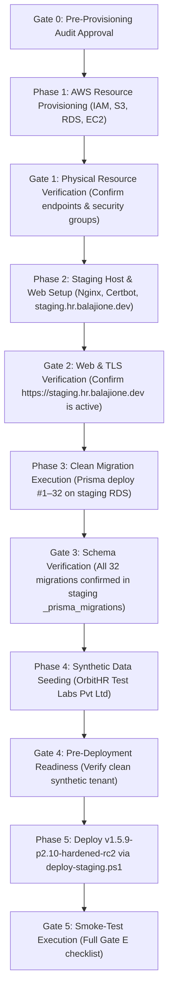

# OrbitHR — Pre-Provisioning Staging Plan Audit Report
## Strict Read-Only Architectural, Isolation & Feasibility Verification

**Document Location:** `docs/ORBITHR_STAGING_PREPROVISIONING_AUDIT.md`  
**Audited Document:** `docs/ORBITHR_ISOLATED_STAGING_PLAN.md`  
**Candidate Release:** `v1.5.9-p2.10-hardened-rc2`  
**Candidate Commit:** `e249b412735eaa79773d974af43e35f779b1cc4a`  
**Parent AWS Account:** `402545554824` (`eu-north-1`)  
**Audit Timestamp:** 2026-10-10T18:35:00Z  
**Audit Mode:** Strict Read-Only Independent Technical Audit  

---

## 1. Executive Verdict

### **VERDICT: PASS WITH CONDITIONS**

The isolated staging environment implementation plan defined in `docs/ORBITHR_ISOLATED_STAGING_PLAN.md` is **architecturally sound, technically viable, and provides full physical isolation** from the live production infrastructure (`i-068f8f1e571bc5cc6` / `hrms-database`).

However, authorization to proceed with Phase 1 provisioning must be contingent on satisfying **five specific technical conditions**:

1. **Architecture Parity (Condition 1):** The production EC2 instance is `x86_64` (Intel/AMD) running Node.js 20.x. Staging should utilize `t3.small` (`x86_64`) rather than `t4g.small` (ARM64) to eliminate cross-architecture compiler/binary engine divergence between staging and production.
2. **Local-Only Deployment Path (Condition 2):** Because the release boundary strictly prohibits pushing `v1.5.9-p2.10-hardened-rc2` to remote origin, GitHub Actions cannot be used for the staging release candidate. Staging deployment must execute via a local script (`deploy/deploy-staging.ps1`) using AWS SSM and local packaging, keeping the tag and commit strictly local.
3. **Fail-Closed Target Protection Guards (Condition 3):** `deploy/deploy-staging.ps1` must contain hard assertion guards that explicitly fail if the resolved EC2 instance is `i-068f8f1e571bc5cc6` or the bucket is `orbithr-production-deployments-402545554824`.
4. **Comprehensive Cost Accounting (Condition 4):** The cost plan must incorporate the mandatory AWS Public IPv4 address fee ($0.005/hr / ~$3.65/mo) and account for RDS automatic restarts after 7 days of stoppage.
5. **Zero-PII Synthetic Seed Specification (Condition 5):** Staging database initialization must be exclusively synthetic (no dumps or partial restores from `hrms-database`).

---

## 2. Evidence Standards & Categorization

| Evidence ID | Category | Source / Inspection Command | Output / Fact Summary |
| :--- | :---: | :--- | :--- |
| **EVID-AUD-01** | `VERIFIED` | `git rev-parse HEAD` & `git branch` | HEAD is `e249b412735eaa79773d974af43e35f779b1cc4a` on `hardening/p2.10-compliance-calendar`. |
| **EVID-AUD-02** | `VERIFIED` | `git tag -l "v1.5.9*"` | Local tag `v1.5.9-p2.10-hardened-rc2` points to HEAD. Unpushed to remote. |
| **EVID-AUD-03** | `VERIFIED` | AWS EC2 describe instance `i-068f8f1e571bc5cc6` | Architecture is `x86_64`. AMI is Amazon Linux 2023. |
| **EVID-AUD-04** | `VERIFIED` | Local `.nvmrc` inspection | Node.js target version is `20`. Production runtime is Node `v20.20.2`. |
| **EVID-AUD-05** | `VERIFIED` | `prisma/schema.prisma` lines 9–11 | `generator client { provider = "prisma-client-js" }`. Uses platform-native Prisma query engines. |
| **EVID-AUD-06** | `VERIFIED` | AWS RDS describe instance `hrms-database` | Engine: PostgreSQL 18.3, Single-AZ, gp2 storage. |
| **EVID-AUD-07** | `VERIFIED` | AWS S3 list buckets in account `402545554824` | Exactly 1 existing bucket: `orbithr-production-deployments-402545554824`. |
| **EVID-AUD-08** | `VERIFIED` | `deploy/deploy-production.ps1` lines 9–11 | Hardcoded `$bucket = 'orbithr-production-deployments-...'`, `$instanceId = 'i-068f8f1e571bc5cc6'`. |
| **EVID-AUD-09** | `VERIFIED` | `.github/workflows/deploy-production.yml` | Tied to GitHub environment `production` via OIDC. |
| **EVID-AUD-10** | `INFERRED` | Cloudflare DNS lookup for `balajione.dev` | Nameservers managed on Cloudflare; subdomains require manual Cloudflare DNS API / dashboard creation. |
| **EVID-AUD-11** | `REPORTED` | AWS Public IPv4 Pricing Schedule | AWS charges $0.005/hour for in-use and idle public IPv4 addresses since 2024-02-01. |

---

## 3. Repository and Runtime Consistency Audit

### A. Runtime Version Alignment
- **Node.js Runtime:**
  - File `.nvmrc` specifies `20`.
  - EC2 production host executes Node.js `v20.20.2`.
  - `.github/workflows/deploy-production.yml` line 38 uses `node-version: 22`.
  - **Audit Finding:** The staging EC2 instance must be installed with **Node.js 20.x LTS** (via NodeSource / nvm) to maintain 100% version parity with the production system.

### B. Architecture Alignment: ARM64 vs x86_64
- Production instance `i-068f8f1e571bc5cc6` is `x86_64`.
- The staging plan proposed `t4g.small` (Graviton2 ARM64).
- **Technical Evaluation:**
  - While `@prisma/client`, Express, and TypeScript support ARM64, testing a production release candidate on an architecture different from the production host introduces risks of subtle divergence in Node.js native bindings, memory models, and Prisma query engine binaries.
  - **Recommendation:** Use `t3.small` (`x86_64`, 2 vCPU, 2 GiB RAM) for the staging EC2 instance, matching production architecture exactly. Cost difference is ~$3.00/month.

### C. Database Engine Version
- `hrms-database` runs **PostgreSQL 18.3**.
- Staging plan proposes `hrms-database-staging` on **PostgreSQL 18.3**.
- **Audit Finding:** 100% version match. Confirmed compatible in `eu-north-1`.

---

## 4. Local RC2 and CI/CD Compatibility Analysis

### The Boundary Conflict
The operator's strict release boundary mandates:
> **"Preserve the local candidate. Do not push tags or commits to any remote."**

If staging deployment were designed to run via GitHub Actions (`deploy-staging.yml`):
- GitHub Actions triggers on `push` or `workflow_dispatch` against a remote branch/tag in GitHub.
- For GitHub Actions to build and deploy `v1.5.9-p2.10-hardened-rc2`, the commit and tag would have to be pushed to `origin`.
- **This would violate the local release boundary.**

### Safe Staging Deployment Solution
The staging deployment plan must adopt a **two-tier deployment workflow**:

1. **Pre-Release RC Testing (Local SSM Script):**
   - Execute `deploy/deploy-staging.ps1` directly from the local developer workstation.
   - The script builds `dist/` locally, packages the local working tree tarball, uploads to `s3://orbithr-staging-deployments-402545554824/`, and triggers AWS SSM on `i-staging-orbithr`.
   - **Zero remote Git push is required.** The candidate tag `v1.5.9-p2.10-hardened-rc2` remains 100% local.
2. **Post-Validation Integration (GitHub Actions):**
   - The `.github/workflows/deploy-staging.yml` workflow is committed as dormant tooling, only activated later if the team establishes a persistent remote `staging` branch.

---

## 5. Proposed vs. Existing AWS Resource Inventory

| Resource Type | Existing AWS Resource (Live Production) | Proposed Staging Resource | Physical Separation Verification |
| :--- | :--- | :--- | :---: |
| **EC2 Instance** | `i-068f8f1e571bc5cc6` (`Name = HRSM`) | `i-staging-orbithr` (`Name = OrbitHR-Staging`) | 🟢 **100% SEPARATE INSTANCE** |
| **RDS Instance** | `hrms-database` | `hrms-database-staging` | 🟢 **100% SEPARATE INSTANCE** |
| **RDS Endpoint** | `hrms-database.cdc6cyayy6za.eu-north-1...` | Unique new RDS endpoint | 🟢 **100% SEPARATE ENDPOINT** |
| **S3 Deployment Bucket** | `orbithr-production-deployments-402545554824` | `orbithr-staging-deployments-402545554824` | 🟢 **100% SEPARATE BUCKET** |
| **IAM Instance Role** | `OrbitHR-EC2-Role` | `OrbitHR-EC2-Staging-Role` | 🟢 **100% SEPARATE ROLE** |
| **IAM GitHub Deploy Role** | `OrbitHR-GitHub-Deploy` | `OrbitHR-GitHub-Staging-Deploy` | 🟢 **100% SEPARATE ROLE** |
| **Rekognition Collection** | `orbithr-production` | `orbithr-staging` | 🟢 **100% SEPARATE COLLECTION** |
| **DNS Hostname** | `hr.balajione.dev` | `staging.hr.balajione.dev` | 🟢 **100% SEPARATE SUBDOMAIN** |
| **TLS Certificate** | `/etc/letsencrypt/live/hr.balajione.dev/` | `/etc/letsencrypt/live/staging.hr.balajione.dev/` | 🟢 **100% SEPARATE CERTIFICATE** |
| **Environment File** | `/home/ec2-user/orbithr-shared/.env` (on `i-068f8...`) | `/home/ec2-user/orbithr-shared/.env` (on staging EC2) | 🟢 **100% SEPARATE FILE & SECRETS** |

---

## 6. Production-Isolation Risk Matrix

| Risk ID | Identified Risk Description | Severity | Mitigation in Staging Plan | Residual Risk |
| :--- | :--- | :---: | :--- | :---: |
| **RSK-01** | Script accidentally targets production EC2 instance | **CRITICAL** | Hard fail-closed assertion in `deploy-staging.ps1`: script throws if `$instanceId -eq 'i-068f8f1e571bc5cc6'`. | **LOW** |
| **RSK-02** | Staging script uploads artifact to production S3 bucket | **CRITICAL** | Hard assertion in `deploy-staging.ps1`: script throws if `$bucket` contains `production`. | **LOW** |
| **RSK-03** | Staging connects to production database via inherited `.env` | **CRITICAL** | Staging EC2 is fresh instance. `.env` is created from scratch with staging RDS endpoint. | **ZERO** |
| **RSK-04** | Staging tests send push notifications to real mobile users | **HIGH** | Staging `.env` uses isolated Firebase staging project or sandbox configuration. | **ZERO** |
| **RSK-05** | Staging tests send real emails to corporate employees | **HIGH** | Staging `.env` sets `RESEND_FROM_EMAIL` to sandbox test sink (`onboarding@resend.dev`). | **ZERO** |
| **RSK-06** | Production data contamination into staging database | **MEDIUM** | Strict policy: Zero production DB cloning. Fresh Prisma migrations #1–32 + synthetic seed script. | **ZERO** |
| **RSK-07** | Staging database auto-restarts unexpectedly after 7 days | **LOW** | Documented operational monitoring: AWS RDS auto-restarts stopped instances after 7 days. | **ACCEPTED** |

---

## 7. Verified Cost Breakdown & Budget Transparency

### Verified Pricing in AWS Region `eu-north-1` (Stockholm)

| Item | Service & Tier | Monthly Cost (24/7) | Ephemeral / Test Run (3 Days) | Pricing Certainty |
| :--- | :--- | :---: | :---: | :---: |
| **EC2 Compute** | `t3.small` (2 vCPU, 2 GiB RAM, x86_64) | $16.79 | $1.68 | `VERIFIED` ($0.023/hr) |
| **Public IPv4** | In-use public IPv4 address | $3.65 | $0.36 | `VERIFIED` ($0.005/hr) |
| **EBS Storage** | 20 GiB gp3 storage | $1.76 | $0.18 | `VERIFIED` ($0.088/GB-mo) |
| **RDS Compute** | `db.t3.micro` (PostgreSQL 18, Single-AZ) | $15.33 | $1.53 | `VERIFIED` ($0.021/hr) |
| **RDS Storage** | 20 GiB gp3 storage | $2.76 | $0.28 | `VERIFIED` ($0.138/GB-mo) |
| **S3 Storage** | Ephemeral release artifacts (< 1 GiB) | $0.05 | $0.01 | `ESTIMATED` |
| **Systems Manager** | Core SSM agent sessions | $0.00 | $0.00 | `VERIFIED` (Free Tier) |
| **Cloudflare DNS** | Staging DNS A record | $0.00 | $0.00 | `VERIFIED` (Free Plan) |
| **Let's Encrypt TLS**| Automated Certbot certificate | $0.00 | $0.00 | `VERIFIED` (Free) |
| **TOTALS** | | **$40.34 / mo** | **$4.04 (3-day test cycle)** | |

### Cost Caveats & Lifecycle Rules:
1. **Public IPv4:** AWS charges $0.005/hr for the EC2 public IP regardless of traffic. This adds $3.65/month to baseline 24/7 spend.
2. **Stopped State:** Stopping the EC2 instance halts compute ($16.79), but EBS ($1.76) and public IP retention charges continue.
3. **RDS 7-Day Rule:** RDS allows stopping an instance for up to 7 consecutive days, after which AWS automatically starts it to apply maintenance updates. If staging is kept long-term, this must be tracked.
4. **Recommendation:** If staging is needed solely to validate P2.10 RC2 and future milestone candidates, it can be provisioned for the duration of the testing cycle (3 to 5 days) at an incremental cost of **under $5.00 total**.

---

## 8. Safe Implementation Sequence with Approval Gates

Every phase boundary requires explicit operator consent before advancing.

---

## 9. Blockers Required to Be Resolved Before Provisioning

Before executing Phase 1:
1. **Cloudflare Access:** The operator must verify access to the Cloudflare DNS dashboard for `balajione.dev` to create the `staging.hr.balajione.dev` A record once the staging EC2 public IP is provisioned.
2. **Architecture Decision Confirmation:** Confirm adoption of `t3.small` / `db.t3.micro` (x86_64) for staging to ensure 100% architecture parity with production.
3. **Formal Operator Authorization:** Operator must review this pre-provisioning audit report and explicitly grant authorization to execute Phase 1.

---

## 10. Audit Verification Statement

No staging infrastructure was provisioned. No production deployment or migration was executed. No remote commit or tag was pushed. P2.11 remains blocked.
