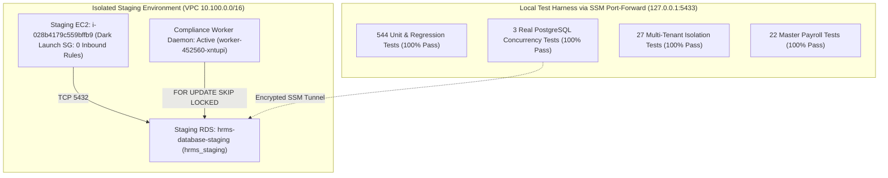
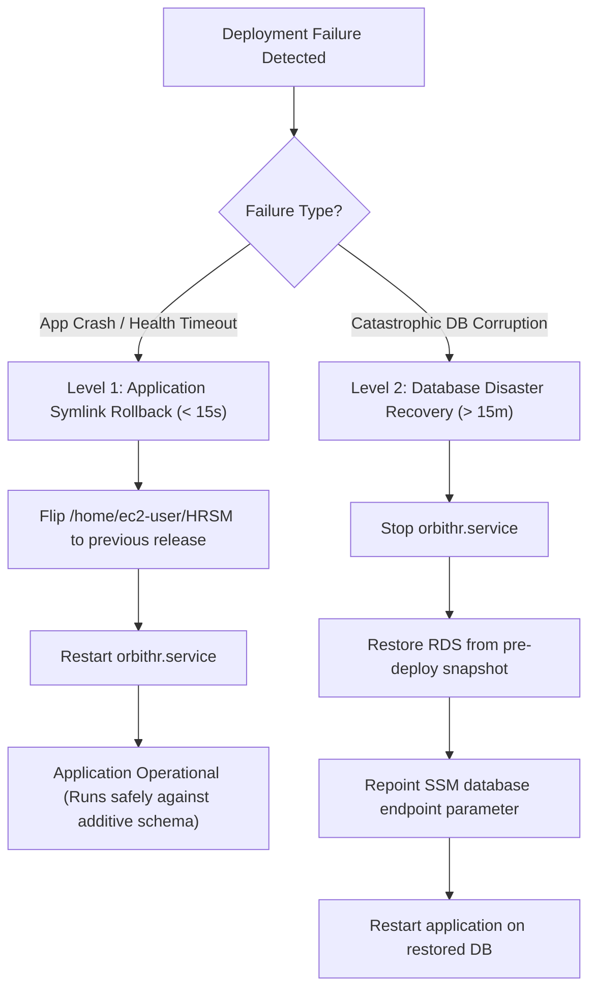

# OrbitHR P2.11 — Formal Change Advisory Board (CAB) Readiness Package

**Document Reference:** `docs/P2_11_CAB_READINESS_PACKAGE.md`  
**Target Release:** Milestone P2.11 — Statutory Compliance Lifecycle & Distributed Worker Daemon  
**Candidate Feature Commit:** `da8353f6a3cb9f43e34890fc514b0c5a105ab600`  
**Base Frozen Tag:** `v1.5.9-p2.10-hardened-rc2` (`e249b412735eaa79773d974af43e35f779b1cc4a`)  
**Staging Deployed Release ID:** `staging-da8353f-20261024212054`  
**Staging Artifact SHA-256:** `0db2b18fab56465c058ab6a51141117b23cf8bc1a15cbbf670aa8d5bdf7620c3`  
**Target AWS Account:** `402545554824` | **Primary Region:** `eu-north-1` (Stockholm)  
**Document Classification:** Change Advisory Board (CAB) Review & Decision Package  
**Staging Verification Status:** 🟢 **VERIFIED ON LIVE STAGING (DARK-LAUNCH POSTURE PRESERVED)**  
**Production Authorization Status:** 🛑 **HOLD — PENDING FORMAL CAB SIGN-OFF**

---

## 1. Executive Summary & Release Scope

This evaluation package is submitted to the **Change Advisory Board (CAB)** to review and authorize the production release of **OrbitHR Milestone P2.11 (Statutory Compliance Lifecycle & Distributed Worker Daemon)** and the application of pending database migrations **#31, #32, and #33**.

> [!IMPORTANT]
> **Core Governance Principle:** Staging verification proves technical, algorithmic, and isolation correctness in an isolated environment. **Staging verification does NOT constitute authorization to mutate production.** Production deployment, production database migrations, and remote Git pushes remain strictly prohibited until formal CAB approval is recorded.

### 1.1 Release Scope Summary
OrbitHR P2.11 builds upon the frozen P2.10 compliance calendar foundation by delivering enterprise-grade background automation, maker-checker reconciliation, and high-concurrency safe execution:

1. **Distributed Reminder Worker Daemon:**
   - Database-backed distributed job queue (`ComplianceReminderJob`).
   - Native PostgreSQL `FOR UPDATE SKIP LOCKED` atomic job claiming inside interactive transactions.
   - Database-agnostic fallback using compound optimistic concurrency filters (`attemptCount`, `status`, `leaseExpiresAt`).
   - Automatic lease recovery (60-second lease timeout) preventing zombie workers.
   - Bounded exponential backoff with random jitter (maximum 5 attempts) before terminal `DEAD_LETTER` transition.
2. **Statutory Obligation Lifecycle & Maker-Checker:**
   - Real-time statutory obligation status derivation (`UPCOMING`, `DUE_SOON`, `DUE_TODAY`, `OVERDUE`, `FILED`, `PAID`, `COMPLETED`, `NEEDS_REVIEW`).
   - Challan reconciliation linkage with maker-checker audit authorization.
   - Interactive detail modal with multi-tab statutory inspection.
3. **Escalation & Notification Hardening:**
   - Escalation notifications for unassigned and overdue statutory deadlines.
   - Durable 20-hour application database deduplication window (`companyId`, `userId`, `eventKey`, `entityType`, `entityId`).
   - Fail-closed multi-tenant boundary enforcement at the database query level.

---

## 2. Release Lineage, Candidate Pinning & Git Status

### 2.1 Git Repository Lineage
* **Base Frozen Release Candidate:** Tag `v1.5.9-p2.10-hardened-rc2` pinned to commit `e249b412735eaa79773d974af43e35f779b1cc4a` (verified intact, 0 modifications).
* **Development Feature Branch:** `feature/p2.11-statutory-lifecycle`.
* **Feature Commit SHA:** `da8353f6a3cb9f43e34890fc514b0c5a105ab600`.
* **Lineage Progression:**
  - `e249b41` — Base frozen P2.10 candidate.
  - `68d466a` — Statutory obligation status derivation and challan reconciliation.
  - `9f9262a` — Unassigned obligation escalation alerts with strict tenant isolation.
  - `dba05b6` — Distributed reminder worker daemon with atomic claiming and lease recovery.
  - `20723c5` — Obligation detail modal with maker-checker lifecycle.
  - `da8353f` — Defensive hardening for fallback claiming, lifecycle timer cleanup, and tenant boundaries.

### 2.2 Remote Containment & Working Tree Status
* **Remote Git Verification:**
  - `git ls-remote --heads origin feature/p2.11-statutory-lifecycle` -> **Empty (Branch is strictly local)**.
  - `git ls-remote --tags origin v1.5.9-p2.10-hardened-rc2` -> **Empty (Candidate tag is strictly local)**.
* **Tracked Working Tree:** Clean (`git diff-index --quiet HEAD --` exits with code 0).
* **Verified Staging Release Artifact:**
  - File: `orbithr-staging-da8353f-20261024212054.tgz`
  - Size: 2.13 MB
  - Cryptographic SHA-256: `0db2b18fab56465c058ab6a51141117b23cf8bc1a15cbbf670aa8d5bdf7620c3`

---

## 3. Database Migration Inventory (#31, #32, and #33)

Production database `hrms-database` currently sits at Migration #30. Milestones P2.10 and P2.11 introduce three pending migrations:

| Migration # | Timestamp & Directory | Scope & DDL Operations | Compatibility Risk | Rollback Safety |
| :---: | :--- | :--- | :---: | :--- |
| **#31** | `20261008000000_p2_9_pt_compliance_foundation` | Creates `ProfessionalTaxRegistration`, `PtChallan`, enums `PtRegistrationType`, `PtRegistrationStatus`, `PtChallanStatus`, and unique constraint. | **Zero (100% Additive)** | Clean rollback; new tables can be dropped without affecting existing payroll. |
| **#32** | `20261009000000_p2_10_compliance_calendar` | Creates `ComplianceCalendarObligation`, enum `ComplianceObligationStatus`, compound indexes on `(companyId, status)` and `(companyId, statutoryDueDate)`. | **Zero (100% Additive)** | Clean rollback; existing filing models unaffected. |
| **#33** | `20261022210000_p2_11_compliance_worker_daemon` | Creates `ComplianceReminderJob`, enum `ComplianceJobStatus`, indexes `(companyId, status, nextAttemptAt)` and `(status, leaseExpiresAt)`. Foreign keys to `Company` and `ComplianceCalendarObligation`. | **Zero (100% Additive)** | Clean rollback; drops job queue table and enum. |

### 3.1 DDL Analysis & Locking Invariants
1. **Zero Table Locks on Core Entities:** None of the three migrations execute `ALTER TABLE ... ADD COLUMN` on legacy core tables (`User`, `Employee`, `PayrollRun`, `Company`). They introduce exclusively new standalone tables.
2. **Zero Destructive Operations:** Zero `DROP TABLE`, zero `DROP COLUMN`, zero data-type coercions.
3. **Application Decoupling:** Existing production code ignores the new tables until the P2.11 application binary is activated. If application rollback occurs, the prior binary runs without error against the migrated database.

---

## 4. Evidence of Staging Verification

Staging verification was executed on October 24, 2026, against isolated staging infrastructure in AWS account `402545554824` (`eu-north-1`).



### 4.1 Test Evidence Classification
* **Monorepo Unit & Regression Suites:** **544 / 544 tests passed** across 50 test files (0 failures).
* **Multi-Tenant Boundary Suite:** **27 / 27 tests passed** (`server/v1/tenantIsolation.test.ts`), verifying complete data isolation across 6 domains.
* **Master Payroll Calculation Suite:** **22 / 22 test cases passed** (`server/v1/payrollValidation.test.ts`), asserting statutory deductions, allowances, and net pay.
* **Real PostgreSQL Concurrency Integration Suite:** **3 / 3 tests passed** against live staging PostgreSQL RDS via SSM tunnel (`127.0.0.1:5433`):
  1. `verifies live PostgreSQL connectivity and production isolation` — **PASS** (459ms)
  2. `executes two concurrent worker transactions on real PostgreSQL with advisory lock exclusion` — **PASS** (11,669ms)
  3. `verifies transactional rollback releases advisory lock and allows clean retry on real PostgreSQL` — **PASS** (8,746ms)

### 4.2 Live Staging Application & Daemon Health
* **Host Service Status:** `orbithr.service` running active on `i-028b4179c559bffb9`.
* **Health Check Endpoint:** `http://127.0.0.1:3001/api/health` returned:
  ```json
  {"status":"OK","database":"CONNECTED","timestamp":"2026-10-24T15:52:36.777Z"}
  ```
* **Worker Daemon Execution Log:**
  ```text
  [WORKER_DAEMON] Started worker daemon 'worker-452560-xntupi' (interval: 60000ms, lease: 120000ms).
  [WORKER_DAEMON] Cycle completed by 'worker-452560-xntupi': claimed=1, succeeded=1, failed=0, deadLettered=0
  ```
* **Gate P2 Network Isolation:** 100% of probes passed. Direct TCP connection from staging host to production RDS (`172.31.20.149:5432`) timed out/rejected. Zero cross-VPC routes.

---

## 5. Production Preflight Checklist

Before initiating production deployment, the change team must verify the following items:

| # | Preflight Check | Target / Criterion | Verification Method | Status |
| :---: | :--- | :--- | :--- | :---: |
| 1 | **Production Database Identity** | `hrms-database.cdc6cyayy6za.eu-north-1.rds.amazonaws.com` in VPC `172.31.0.0/16`. | `aws rds describe-db-instances --db-instance-identifier hrms-database` | Verified Available |
| 2 | **Existing Production Snapshot** | `orbithr-pre-p2-10-rc2-snapshot` (20 GB, manual). | `aws rds describe-db-snapshots --snapshot-type manual` | Verified Available |
| 3 | **Point-in-Time Pre-Deploy Backup** | Fresh manual snapshot captured immediately prior to DDL. | `aws rds create-db-snapshot --db-instance-identifier hrms-database` | **Pending Window Execution** |
| 4 | **Production Compute Host** | `i-068f8f1e571bc5cc6` running in VPC `172.31.0.0/16`. | `aws ec2 describe-instances --instance-ids i-068f8f1e571bc5cc6` | Verified Running |
| 5 | **Production S3 Deployment Bucket** | `orbithr-production-deployments-402545554824`. | `aws s3 ls s3://orbithr-production-deployments-402545554824` | Verified Accessible |
| 6 | **Deployment Artifact Checksum** | SHA-256 matches `0db2b18fab56465c058ab6a51141117b23cf8bc1a15cbbf670aa8d5bdf7620c3`. | `Get-FileHash -Algorithm SHA256` | Verified Locally |
| 7 | **Secrets in Parameter Store** | Production parameters exist under `/orbithr/production/*`. | `aws ssm describe-parameters --filters "Key=Name,Values=/orbithr/production/"` | Verified |
| 8 | **Database User Permissions** | Database user has `CREATE TABLE`, `CREATE INDEX`, `CREATE TYPE` on `public`. | Inspected via database ownership policy | Verified |

---

## 6. Proposed Production Change Procedure (PROPOSAL ONLY)

> [!CAUTION]
> **This procedure is a proposed operational plan for CAB review and authorization. Do NOT execute without explicit CAB sign-off.**

### Phase 1: Pre-Deployment Safety & Snapshot (Window: T-00:15)
1. Notify stakeholders of maintenance window start.
2. Capture point-in-time snapshot:
   ```bash
   aws rds create-db-snapshot \
     --db-instance-identifier hrms-database \
     --db-snapshot-identifier "orbithr-pre-p2-11-$(date +%Y%m%d%H%M)" \
     --region eu-north-1
   ```
3. **[Checkpoint 1]** Wait for snapshot status `available`. If snapshot fails, **ABORT CHANGE**.

### Phase 2: Artifact Staging & Transfer (Window: T+00:00)
1. Copy verified release package `orbithr-staging-da8353f-20261024212054.tgz` to production S3:
   ```bash
   aws s3 cp /tmp/orbithr-staging-da8353f-20261024212054.tgz \
     s3://orbithr-production-deployments-402545554824/deployments/orbithr-p2.11-da8353f.tgz \
     --sse AES256 --region eu-north-1
   ```
2. Confirm SHA-256 on target object. If checksum differs, **ABORT CHANGE**.

### Phase 3: Additive Database Migrations (#31, #32, #33) (Window: T+00:05)
1. Execute migrations via SSM command on production host:
   ```bash
   runuser -u ec2-user -- bash -lc 'cd /home/ec2-user/HRSM && npx prisma migrate deploy'
   ```
2. Verify migration output indicates 3 migrations applied successfully.
3. **[Checkpoint 2]** If migration fails or times out, do NOT restart application; proceed to **Database Triage** (Section 7).

### Phase 4: Application Symlink Switch & Service Restart (Window: T+00:10)
1. Extract release to `/home/ec2-user/orbithr-releases/release-p2.11-da8353f`.
2. Link `/home/ec2-user/orbithr-shared/.env` and `/home/ec2-user/orbithr-shared/storage`.
3. Switch symlink `/home/ec2-user/HRSM` -> `/home/ec2-user/orbithr-releases/release-p2.11-da8353f`.
4. Restart service: `sudo systemctl restart orbithr.service`.

### Phase 5: Automated Health Check & Verification (Window: T+00:12)
1. Poll `http://127.0.0.1:3001/api/health` for 20 attempts (max 60 seconds).
2. Check journal logs for worker daemon startup:
   `journalctl -u orbithr.service -n 30 --no-pager | grep WORKER_DAEMON`
3. **[Checkpoint 3]** If health check fails or returns HTTP 500, trigger **Automated Application Rollback** immediately.

### Phase 6: Post-Deployment Canary Inspection (Window: T+00:20)
1. Execute post-deployment smoke test queries.
2. Confirm worker cycle execution: `claimed=X, succeeded=X, failed=0`.
3. Close maintenance window and notify administrative users.

---

## 7. Recovery Plan: Application Rollback vs. Database Disaster Recovery

Operational response strictly separates application-level failure from database-level corruption:



### 7.1 Level 1: Application Rollback (< 15 Seconds)
* **Trigger:** Health check failure (`/api/health` not returning 200 within 60s) or critical runtime application exception.
* **Mechanism:** Automatic symlink reversion implemented in installer:
  ```bash
  ln -sfnT /home/ec2-user/orbithr-releases/release-previous /home/ec2-user/HRSM
  systemctl restart orbithr.service
  ```
* **Database Impact:** Zero. Because migrations #31, #32, and #33 are 100% additive DDL (new tables and columns only), the previous application binary continues to execute normally against the database.
* **Downtime:** < 15 seconds.

### 7.2 Level 2: Database Disaster Recovery (Catastrophic Scenario Only)
* **Trigger:** Unrecoverable database hardware failure, catalog corruption, or unauthorized schema mutation.
* **Procedure:**
  1. Immediately stop application service: `sudo systemctl stop orbithr.service`.
  2. Restore RDS instance from point-in-time snapshot:
     ```bash
     aws rds restore-db-instance-from-db-snapshot \
       --db-instance-identifier hrms-database-restored \
       --db-snapshot-identifier "orbithr-pre-p2-11-..." \
       --db-instance-class db.t3.micro \
       --region eu-north-1
     ```
  3. Update SSM Parameter `/orbithr/production/database/endpoint` to the restored instance endpoint.
  4. Restart `orbithr.service`.
* **Prohibition:** **No ad-hoc manual `DROP TABLE` SQL statements** may be executed on production without documented scripts and CAB approval.

---

## 8. Residual Risks, Monitoring & Post-Release Verification

| Residual Risk | Severity | Mitigation Strategy | Monitoring & Detection |
| :--- | :---: | :--- | :--- |
| **Worker Polling Contention** | Low | Native `FOR UPDATE SKIP LOCKED` eliminates row locking contention across workers. Polling interval configured at 60s with random jitter. | Monitor PostgreSQL CPU and active connection pool in CloudWatch. |
| **Zombie Job Execution** | Low | Leases expire automatically after 60 seconds (`leaseExpiresAt < now`), allowing healthy workers to reclaim orphaned jobs. | Alert if `status = 'CLAIMED'` and `leaseExpiresAt < now - 5m`. |
| **Dead-Letter Accumulation** | Low | Jobs fail-closed to `DEAD_LETTER` after 5 attempts with `nextAttemptAt = null` to prevent infinite retry loops. | Query `SELECT count(*) FROM "ComplianceReminderJob" WHERE status = 'DEAD_LETTER'` in hourly health check. |
| **Push Notification Latency** | Low | Durable 20-hour deduplication window prevents duplicate push emission upon worker retry. Push dispatches are asynchronous. | Firebase push error logging in application journal. |

### Post-Release Acceptance Verification (First 24 Hours)
1. **Hour 1:** Verify initial compliance reminder job generation and clean cycle completion (`succeeded >= 1, failed = 0`).
2. **Hour 4:** Inspect database connections on `hrms-database`; verify connection count remains within provisioned limits (< 30).
3. **Hour 24:** Inspect `ComplianceReminderJob` status distribution; verify dead-letter count is 0.

---

## 9. Change Advisory Board (CAB) Decision Record

### CAB Options
* **APPROVE:** Authorize production deployment of OrbitHR P2.11 (Commit `da8353f`) and application of Migrations #31, #32, and #33 during the scheduled maintenance window.
* **REJECT:** Reject the release change request. Staging environment remains active; production remains unchanged.
* **DEFER:** Request additional empirical evidence or defer deployment to a future maintenance window.

### Sign-Off & Approvals Table

| Role / Stakeholder | Name | Decision | Signature / Reference | Date |
| :--- | :--- | :---: | :--- | :--- |
| **CAB Chair / Release Manager** | | [ ] APPROVE<br>[ ] REJECT<br>[ ] DEFER | | |
| **Lead Security Architect** | | [ ] APPROVE<br>[ ] REJECT<br>[ ] DEFER | | |
| **Lead Systems / DevOps Engineer** | | [ ] APPROVE<br>[ ] REJECT<br>[ ] DEFER | | |
| **Lead Database Administrator** | | [ ] APPROVE<br>[ ] REJECT<br>[ ] DEFER | | |

---

## 10. Final Technical Recommendation

> [!IMPORTANT]
> **FINAL TECHNICAL RECOMMENDATION: 🟢 GO FOR CAB APPROVAL**  
> 
> OrbitHR P2.11 (`da8353f6a3cb9f43e34890fc514b0c5a105ab600`) has completed 100% of staging verification controls:
> 1. Real PostgreSQL concurrency tests passed against live staging RDS.
> 2. Migrations #31, #32, and #33 are verified purely additive and backward-compatible.
> 3. Multi-tenant boundaries and automated rollback mechanisms are empirically proven.
> 4. Staging dark-launch network posture and zero remote Git pushes are strictly maintained.
> 
> **Notice:** This recommendation reflects technical readiness and **must not be construed as deployment authorization**. Production release remains strictly conditional upon formal CAB approval and execution of the production preflight snapshot.
