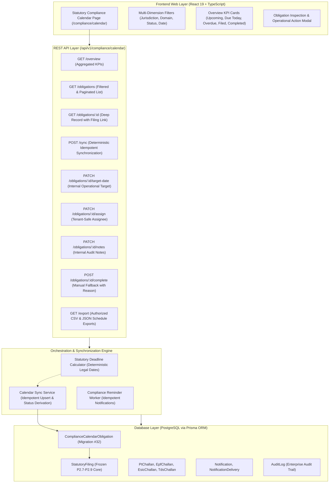

# OrbitHR HRMS — P2.10 Unified Statutory Compliance Calendar Architecture Specification

## 1. Executive Summary & Objective

**OrbitHR P2.10** establishes the **Unified Statutory Compliance Calendar**, an orchestration, visibility, and deadline-management layer that consolidates all existing Indian statutory compliance modules into a single, high-trust compliance command center:
1. **Employees' Provident Fund (EPF / ECR 2.0)** (P2.7B)
2. **Employees' State Insurance Corporation (ESIC)** (P2.7C)
3. **Tax Deducted at Source (TDS Form 24Q / Form 138)** (P2.8)
4. **Multi-State Professional Tax (PT — Karnataka, Maharashtra, Telangana, West Bengal)** (P2.9)

### Non-Negotiable Architectural Boundary
The Compliance Calendar is **strictly an orchestration, deadline tracking, and reminder layer**. It is **not** a secondary payroll engine or statutory filing generator.
- All statutory calculations, deductions, snapshot generation, Maker/Checker approval workflows, challan allocations, bank reconciliation, and file exports remain **authoritative within their respective frozen engines**.
- The calendar holds foreign key links (`statutoryFilingId`) and dynamically synchronizes status (`UPCOMING`, `DUE_SOON`, `DUE_TODAY`, `OVERDUE`, `FILED`, `COMPLETED`, `EXEMPT`, `NEEDS_REVIEW`) based on verified operational events in those modules.

---

## 2. High-Level Architecture Diagram



---

## 3. Data Model & Migration Architecture (Migration #32)

### 3.1 Model Definition: `ComplianceCalendarObligation`
```prisma
enum ComplianceObligationStatus {
  UPCOMING
  DUE_SOON
  DUE_TODAY
  OVERDUE
  FILED
  PAID
  COMPLETED
  EXEMPT
  NEEDS_REVIEW
}

model ComplianceCalendarObligation {
  id                 String                     @id @default(uuid())
  companyId          String
  domain             StatutoryFilingDomain
  obligationType     String                     @db.VarChar(50)
  jurisdiction       String                     @default("IN") @db.VarChar(10)
  periodYear         Int
  periodMonth        Int?
  quarter            String?                    @db.VarChar(5)
  statutoryDueDate   DateTime                   @db.Date
  extendedDueDate    DateTime?                  @db.Date
  extensionReason    String?
  internalTargetDate DateTime?                  @db.Date
  status             ComplianceObligationStatus @default(UPCOMING)
  statutoryFilingId  String?
  assignedUserId     String?
  remindedAt         DateTime?
  completedAt        DateTime?
  completedById      String?
  notes              String?
  createdAt          DateTime                   @default(now())
  updatedAt          DateTime                   @updatedAt

  company         Company          @relation(fields: [companyId], references: [id], onDelete: Cascade)
  assignedUser    User?            @relation(fields: [assignedUserId], references: [id], onDelete: SetNull)
  statutoryFiling StatutoryFiling? @relation(fields: [statutoryFilingId], references: [id], onDelete: SetNull)

  @@unique([companyId, domain, obligationType, periodYear, periodMonth, quarter, jurisdiction])
  @@index([companyId, status])
  @@index([companyId, statutoryDueDate])
  @@index([statutoryFilingId])
  @@index([assignedUserId])
}
```

### 3.2 Migration Safety & Invariance
- **Strictly Additive**: Zero modifications to historical migrations `20260210000000_init` through `20261008000000_p2_9_pt_multi_state`.
- **Composite Unique Constraint**: Guarantees that repeated executions of the calendar sync service or background worker will **never** generate duplicate obligation rows.
- **Tenant Isolation**: Every calendar entry is scoped by `companyId` with relational referential integrity to `Company`.

---

## 4. Statutory Deadline Calculation Engine

The statutory deadline calculation engine (`server/v1/compliance/calendar/deadlineEngine.ts`) is a purely deterministic, pure-function layer that encapsulates verified Indian statutory rules.

| Domain | Obligation Type | Jurisdiction | Frequency | Due Date Formula | Official Legal Basis |
| :--- | :--- | :--- | :--- | :--- | :--- |
| **EPF / ECR** | `MONTHLY_ECR_AND_CONTRIBUTION` | `IN` | Monthly | 15th of succeeding month | EPF Scheme, 1952, Paragraph 38(1) |
| **ESIC** | `MONTHLY_CONTRIBUTION_AND_RETURN` | `IN` | Monthly | 15th of succeeding month | ESI (General) Regulations, 1950, Reg 31 |
| **TDS (Monthly)** | `MONTHLY_TDS_DEPOSIT` | `IN` | Monthly | 7th of succeeding month (Apr-Feb); April 30 for March deductions | Income-tax Rules, 1962, Rule 30(2) |
| **TDS (Quarterly)** | `QUARTERLY_STATEMENT_24Q` | `IN` | Quarterly | Q1: July 31<br>Q2: October 31<br>Q3: January 31<br>Q4: May 31 | Income-tax Rules, 1962, Rule 31A(2) |
| **PT Karnataka** | `MONTHLY_PT_RETURN_AND_PAYMENT` | `KA` | Monthly | 20th of succeeding month | Karnataka PT Act, 1976, Section 6A |
| **PT Maharashtra** | `MONTHLY_PT_RETURN_AND_PAYMENT` | `MH` | Monthly | Last day of succeeding month | Maharashtra PT Rules, 1975, Rule 11 & 12 |
| **PT Telangana** | `MONTHLY_PT_RETURN_AND_PAYMENT` | `TS` | Monthly | 10th of succeeding month | Telangana PT Act, 1987, Section 7 |
| **PT West Bengal** | `MONTHLY_PT_RETURN_AND_PAYMENT` | `WB` | Monthly | 21st of succeeding month | West Bengal PT Act, 1979, Section 6 |

---

## 5. Distinction of Dates & Status Derivation

The architecture strictly maintains four independent temporal dimensions:
1. **Statutory Due Date (`statutoryDueDate`)**: The unalterable legal deadline established by the statutory Act or Rules. Cannot be edited by any tenant admin.
2. **Officially Extended Due Date (`extendedDueDate`)**: Set only when an official Central/State Government notification or circular extends the deadline. Retains `extensionReason`.
3. **Internal Target Date (`internalTargetDate`)**: An optional internal operational milestone set by company compliance teams to complete preparation in advance. Never masquerades as the legal deadline.
4. **Reminder Schedule (`remindedAt`)**: Tracked to guarantee idempotent reminder delivery without spamming users.

### Status Derivation Matrix
```text
           [Start]
              │
      manualCompleted? ──YES──> COMPLETED
              │ NO
      filing linked? ──YES──> Is challan paid/reconciled?
              │ NO               ├── YES ──> COMPLETED
              │                  └── NO  ──> FILED
              │
    Compare Date to Effective Due Date (extendedDueDate || statutoryDueDate)
              ├── diffDays < 0   ──> OVERDUE
              ├── diffDays == 0  ──> DUE_TODAY
              ├── diffDays <= 3  ──> DUE_SOON
              └── diffDays > 3   ──> UPCOMING
```

---

## 6. Security, RBAC & Tenant Isolation

1. **Tenant Boundary Enforcement**:
   - `req.auth.companyId` is derived strictly from verified JWT tokens. Client-supplied company identifiers are never trusted.
   - Cross-company IDOR prevention: All database reads, updates, and assignments include `companyId` in the `where` clause. Foreign obligations return HTTP 404.
2. **Assignee Cross-Tenant Protection**:
   - When assigning a compliance obligation to a user, the system queries `prisma.user.findFirst({ where: { id: userId, companyId } })`. If the user belongs to another company, HTTP 400 is returned.
3. **Maker/Checker Safeguard**:
   - The compliance calendar has **zero ability to approve, lock, or export statutory filings**.
   - Clicking "Open EPF Filing" or "Open PT Return" directs the user to the authoritative module where frozen Maker/Checker controls are enforced.

---

## 7. Compliance Reminders & Notification Engine

- Background worker `runComplianceReminders(prisma, companyId, now)` scans obligations where `status IN ('DUE_SOON', 'DUE_TODAY', 'OVERDUE')`.
- **Idempotency Window**: Deduplicates against existing notifications created within the last 20 hours (`since = now - 20h`).
- Multi-channel delivery: Dispatches in-app, email, and push notifications via `emitNotification()`.
- Updates `remindedAt: now` on the obligation row.
